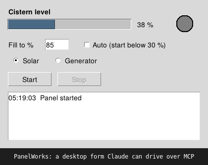
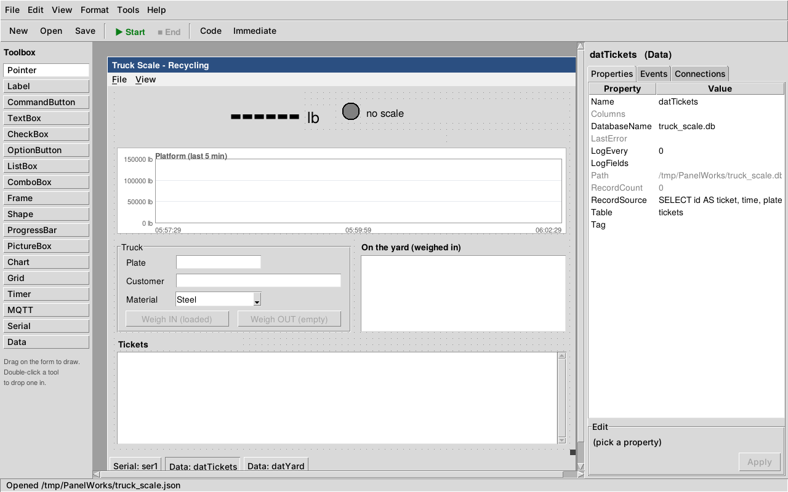
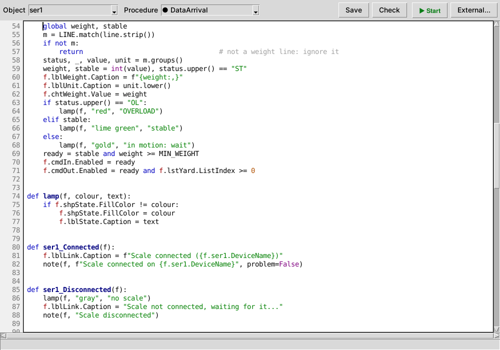
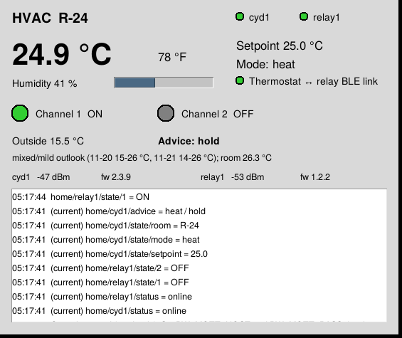

# PanelWorks

Draw a form in JSON, write `Object_Event` procedures in Python, and run it as a
real Tkinter desktop window. Every object is live-addressable, by agents over
**MCP** (Claude can read and set properties, call methods, wait for events, even
draw new controls while the app runs), by devices over **MQTT** (subscribe
properties to topics, publish on events, mirror the whole form) and by
automations over **webhooks** (an n8n workflow can be an event procedure).



*Recorded session: an MCP client (as Claude would) adds an E-STOP button to a
running panel, starts the pump, waits for the E-STOP click, then stops it.
Script: `tests/record_demo.py`.*

The programming model is the classic RAD one: a form, named controls, properties,
methods and events (`cmdStart_Click`), as popularised by Visual Basic and Delphi.
PanelWorks is an independent project and is not affiliated with Microsoft, nor
with the HoloViz "Panel" dashboard library.

```
examples/pumppanel.json    <- a form: objects + properties
examples/pumppanel.py      <- its event procedures
examples/cistern_mqtt.*    <- a no-code panel driven entirely by MQTT subscriptions
examples/n8n_demo.*        <- a panel whose event procedures live in n8n
examples/hvac_console.*    <- read-only HVAC console for real ESP32 devices over MQTT/TLS
examples/n8n/              <- the matching n8n workflow, ready to import
tests/fake_esp32.py        <- simulated cistern node to test it against
panelworks/runtime.py      <- controls, Form, event dispatch, thread bridge
panelworks/mcp_bridge.py   <- MCP server, single-instance lock and relay
panelworks/mqtt.py         <- MQTT control, subscribe / publish / mirror
panelworks/webhooks.py     <- HTTP webhooks (n8n): events out, replies drive the form
panelworks/designer.py     <- the visual form designer
panelworks/codeeditor.py   <- its built-in Code window
panelworks/cli.py          <- the `panelworks` command
```

## Install

Python 3.10+ with Tkinter (included in the python.org Windows/macOS installers;
on Debian/Ubuntu `sudo apt install python3-tk`). From the project folder:

```
python -m venv .venv
.venv\Scripts\python -m pip install -e ".[mqtt]"      # Windows
.venv/bin/python -m pip install -e ".[mqtt]"          # macOS / Linux
```

That installs a `panelworks` command into the venv (`-e` = editable, so changes to
the source take effect without reinstalling). Leave off `[mqtt]` to skip paho-mqtt.

Works with mcp 2.x (tested 2.3.0) and falls back to the 1.x `FastMCP` API.
MQTT needs paho-mqtt 2.x (tested 2.2.0); without it, forms still run, minus MQTT.

## Run

```
panelworks examples/pumppanel.json               # window + MCP at http://127.0.0.1:8765/mcp
panelworks examples/pumppanel.json --mcp stdio   # for Claude Desktop / Claude Code
panelworks examples/pumppanel.json --mcp none    # just the desktop app
python -m panelworks ...                         # same thing, if the command isn't on PATH
```

### Hook it to Claude Desktop

Add a server to `claude_desktop_config.json`. Let the app find the file for you,
because its location varies by install. In Claude Desktop, open **Settings** and type
"developer" in the search box (it isn't in the menu list), choose **Extensions**,
and use its config button to show the file. Open it in Notepad
(right-click → Open with → Notepad).

Typical locations: `%APPDATA%\Claude\` or `%LOCALAPPDATA%\Claude-Data\...` on
Windows, and `~/Library/Application Support/Claude/` on macOS.

**Quit Claude Desktop from the tray icon (or Task Manager) before editing, and
restart it afterwards.** Closing the window only hides it, and the app rewrites
this file while running. If the server doesn't show up, that's the usual cause. If the file already has content, add `mcpServers` as a new top-level
key, and watch the commas:

```json
{
  "mcpServers": {
    "pumppanel": {
      "command": "C:/dev/panelworks/.venv/Scripts/panelworks.exe",
      "args": ["C:/dev/panelworks/examples/pumppanel.json", "--mcp", "stdio"]
    }
  }
}
```

Restart Claude Desktop; the panel window opens and Claude can ask it things like
"press Start", "what's the cistern level?", or "add a Stop-All button under Start".

Claude Code over HTTP: start with the default `--mcp http`, then
`claude mcp add --transport http pumppanel http://127.0.0.1:8765/mcp`.

## Designer: draw forms without writing JSON



**Desktop shortcut (Windows), no console window:** right-click the desktop, then
New > Shortcut, with the location
`C:\path\to\panelworks\.venv\Scripts\pythonw.exe -m panelworks.designer`.
Set **Start in** to the project folder. Under **Change Icon...**, browse to
`panelworks\assets\panelworks.ico`.

```
panelworks-designer                       # new form
panelworks-designer my_panel.json         # open (or create) a form
panelworks --design my_panel.json         # same thing
```

The designer works the way classic RAD tools did, and needs no AI:

- **Draw:** pick a tool in the Toolbox and drag a rectangle on the form, or click
  for a default-size control. Double-click a tool to drop one in.
- **Arrange:** drag to move (5 px snap), drag the black grip to resize, arrow keys
  nudge 1 px (Shift: 10 px). Drag the grip at the form's corner to resize the form.
- **Properties:** pick a row, edit below. True/False and fixed choices get a drop-down,
  colours get a picker, lists are one item per line.
- **Code:** double-click a control (or an event on the **Events** tab, or press **F7**)
  to open the built-in **Code window**. See below.
- **Connections:** MQTT `subscribe` / `publish` and n8n `webhook` entries for the
  selected control, or `mqtt` / `webhooks` for the form, edited as JSON.
- **Keys:** Del, Ctrl+D duplicate, Ctrl+Z undo (50 steps), Ctrl+S save, **F5 run**.
  Timers and MQTT controls sit in the tray under the form, as they did in VB.

### The Code window



Like VB's: pick an **Object** and a **Procedure** at the top to jump to it. If the
procedure doesn't exist yet, a stub is written with `pass` selected, ready to type over.
The dropdowns follow the cursor, and **●** marks procedures that already have code.
`(General)` lists your own helper functions.

- Python colouring, line numbers, Tab = 4 spaces, auto-indent after `:` and
  dedent after `pass`/`return`, Shift+Tab to un-indent, Ctrl+Z / Ctrl+Y.
- **Ctrl+S** saves after a syntax check. A mistake gets its line marked red and
  the reason shown, so a panel never fails to start over a missing bracket.
  **Check** runs the same test without saving.
- **Ctrl+F** / **F3** find. **F5** saves code and form, then runs the panel.
- **External...** opens the file in VS Code (or Notepad). Set `PANELWORKS_EDITOR`
  to make an outside editor the default for double-clicks instead.
- If the `.py` changes on disk (Claude, another editor) and you have no unsaved
  edits, it reloads. If you do, it warns you before saving over it.

Set a Label's **AutoSize** to True and it resizes to fit its caption and font,
including captions your code or an MQTT subscription sets later. While it's on,
Width and Height follow the text.

Files are saved with only the properties you changed, so they stay readable and
diff well in git. Forms written by hand or by Claude open without losing anything
(form-level `mqtt`/`webhooks`, every subscribe/publish/webhook).

**With Claude:** the designer watches the file it has open. When Claude changes the
form (for example `add_object` then `save_form` on a running panel), the designer
reloads it, asking first if you have unsaved edits. Rough a panel out with Claude,
polish it by hand, then have Claude wire up the automations, or the other way round.

## The form file

```json
{
  "name": "PumpPanel",
  "caption": "Cistern Pump Panel",
  "width": 420, "height": 300,
  "code": "pumppanel.py",
  "objects": {
    "cmdStart": {"type": "CommandButton", "Caption": "Start",
                 "Left": 15, "Top": 145, "Width": 90, "Height": 30},
    "tmrSim":   {"type": "Timer", "Interval": 500, "Enabled": true}
  }
}
```

Property names follow the classic RAD conventions (Caption, Text, Value, Left, Top). Positions are pixels from the top-left of the form.

## Event procedures

```python
def cmdStart_Click(f):              # f is the form ("Me")
    f.shpPump.FillColor = "lime green"
    f.cmdStop.Enabled = True
    f.lstLog.AddItem("Pump ON")

def txtSetpoint_KeyPress(f, key_ascii):
    ...

def tmrSim_Timer(f):
    f.barLevel.Value += 1
```

Events are held until the form finishes building, then `Form_Load` fires.
Setting `TextBox.Text` fires `Change`, and setting `CheckBox.Value` /
`OptionButton.Value` fires `Click`, as in classic VB. A handler that raises an exception prints
a traceback and logs the error in the event log; the app keeps running.

## Controls

| Type | Key properties | Methods | Events |
|---|---|---|---|
| Label | Caption, Alignment, AutoSize | | Click, DblClick |
| CommandButton | Caption | Click (press it) | Click, GotFocus, LostFocus |
| TextBox | Text, Locked, PasswordChar, SelText | Clear | Change, KeyPress, GotFocus, LostFocus |
| CheckBox | Caption, Value (0/1) | | Click |
| OptionButton | Caption, Value, Group | | Click |
| ListBox | List, ListIndex, ListCount, Text | AddItem, RemoveItem, Clear | Click, DblClick |
| ComboBox | List, ListIndex, ListCount, Text | AddItem, Clear | Click, Change |
| Shape | Shape (Oval/Rectangle), FillColor, BorderColor | | Click |
| ProgressBar | Value, Max | | |
| Timer | Interval (ms), Enabled | | Timer |
| MQTT | Broker, Port, ClientID, Username, Password, Subscriptions, AutoConnect, Connected | Connect, Disconnect, Publish, Subscribe, Unsubscribe | Connected, Disconnected, MessageArrived |
| Form | Caption, Width, Height, BackColor | MsgBox, Unload | Load, Unload |

All visible controls also have Left, Top, Width, Height, Visible, Enabled,
FontName, FontSize, FontBold, Tag, SetFocus, Refresh; the plain-Tk ones have
BackColor and ForeColor. Ask the `control_types` tool for the authoritative list.

## MCP tools

| Tool | Classic RAD equivalent |
|---|---|
| `describe_form`, `list_objects`, resource `form://describe` | Object browser |
| `get_property`, `set_property` | `x = Label1.Caption`, `Label1.Caption = x` |
| `call_method` | `List1.AddItem "x"`, `Command1.Value = True` (press) |
| `fire_event` | calling `Command1_Click` directly |
| `get_events`, `wait_for_event` | (new) watch what the user does |
| `add_object`, `remove_object`, `save_form` | the form designer |
| `control_types` | the toolbox |
| `mqtt_status`, `mqtt_publish` | (new) the form's MQTT link, subscriptions and publishers |
| `webhook_status` | (new) webhook calls: counts, last error, which events call which URLs |

## MQTT

Two styles, use either or both.

### 1. No code: `subscribe`, `publish`, `mirror` in the JSON

Add an `mqtt` block to the form, then give objects `subscribe` (a topic sets a
property) and `publish` (an event sends to a topic):

```json
"mqtt": {"broker": "localhost", "port": 1883,
         "prefix": "panelworks/cistern", "mirror": true},
"objects": {
  "barLevel": {"type": "ProgressBar",
               "subscribe": {"Value": {"topic": "homestead/cistern/level", "json": "level"}}},
  "lblLevel": {"type": "Label",
               "subscribe": {"Caption": {"topic": "homestead/cistern/level", "json": "level",
                                    "format": "{:.0f} %"}}},
  "shpPump":  {"type": "Shape",
               "subscribe": {"FillColor": {"topic": "homestead/pump/state",
                        "map": {"ON": "lime green", "OFF": "gray", "*": "orange"}}}},
  "txtSetpoint": {"type": "TextBox",
               "subscribe": {"Text": {"topic": "homestead/cistern/setpoint", "twoWay": true}}},
  "cmdStart": {"type": "CommandButton",
               "publish": {"Click": {"topic": "homestead/pump/cmd", "payload": "ON"}}}
}
```

`subscribe` options, applied in this order to each incoming message (`bind` is
accepted as an older alias for `subscribe`):

| Key | Does |
|---|---|
| `topic` | Topic or wildcard filter (`+`, `#`). A bare string means just the topic. |
| `json` | Pick a field from a JSON payload: `"level"`, `"sensors.0.temp"` |
| `map` | Translate values: `{"ON": "green", "*": "orange"}` (`*` = anything else) |
| `scale` | Multiply numeric values |
| `format` | Python format: `"{:.1f} C"`, `"node {}"` |
| `twoWay` | Publish back when the user changes it (TextBox.Text, CheckBox.Value, OptionButton.Value, ComboBox.Text/ListIndex, ListBox.ListIndex) |
| `publishTopic` | Publish two-way changes here instead of `topic` (e.g. a `/set` topic) |
| `retain` | Retain two-way publishes (default true) |

**Connection options** in the `mqtt` block:

| Key | Default | Notes |
|---|---|---|
| `broker` | `localhost` | Host name. `${VAR}` / `${VAR:-default}` allowed, like every value below |
| `port` | 1883, or 8883 with `tls` | |
| `tls` | `false` | Encrypt the connection. Uses the operating system's trusted CAs (fine for Let's Encrypt) |
| `caFile` | | Path to a CA certificate, for private or self-signed brokers |
| `username` / `password` | | Keep the password out of the file: `"password": "${PW_MQTT_PASS}"` |
| `prefix` | `panelworks/<form name>` | Where mirror and status topics go |
| `status` | `true` | Publish `<prefix>/status` online/offline with a Last Will. Set `false` for read-only accounts |

If the broker refuses the login or can't be reached, the reason is printed once,
`Form_MqttError(f, message)` fires, and `mqtt_status` shows it as `last_error`.
The MQTT control has the same `TLS`, `CAFile`, `Username` and `Password`
properties, a `LastError` property, and an `Error` event.

`publish` takes one entry or a list per event. `payload` can template the
object's properties, e.g. `"{Text}"` or `"{Value}"`. If no payload is given, it defaults to `"{Value}"`
or the event name. Optional `retain` and `qos`.

Incoming values that equal the current value are ignored, and a two-way change is
never republished to the topic it arrived on, so there are no echo loops.

**Mirror** (`"mirror": true`) publishes every property of every object, retained,
to `<prefix>/<object>/<property>` whenever it changes (checked every
`mirrorInterval` ms, default 250). It publishes events (except Timer) to `<prefix>/<object>/event`.
Writing `<prefix>/<object>/<property>/set` sets that property, so
`mosquitto_pub -t panelworks/cistern/lblLevel/Caption/set -m hi` works. `<prefix>/status`
is `online`/`offline` (retained, with Last Will). Node-RED, n8n, Home Assistant
and ESP32s see the same object model Claude sees over MCP.

### 2. Code: the MQTT control (like the classic Winsock control)

```json
"mqttMon": {"type": "MQTT", "Broker": "localhost",
            "Subscriptions": ["homestead/pump/#"]}
```
```python
def mqttMon_MessageArrived(f, topic, payload, retained):
    f.lstLog.AddItem(f"{topic} = {payload}")

def cmdFlush_Click(f):
    f.mqttMon.Publish("homestead/valve/flush", "OPEN")
```

It connects on Form_Load (`AutoConnect`), reconnects by itself, and re-subscribes
after a reconnect.

### Try it

```
mosquitto                                        # any broker on localhost:1883
python tests/fake_esp32.py                       # simulated cistern node
panelworks examples/cistern_mqtt.json
mosquitto_sub -t 'panelworks/cistern/#' -v          # watch the form mirror itself
```

## n8n (and any HTTP webhook)

Any event can POST to a webhook, and the **reply drives the form**, so an n8n
workflow can act as an event procedure, with all of n8n's nodes and credentials
behind it. It works from behind any firewall, because the panel always calls out.

```json
"webhooks": {"baseUrl": "${N8N_WEBHOOK_BASE:-https://n8n.example.com/webhook/}",
             "headers": {"X-Panel-Key": "${PANEL_KEY}"},
             "poll": {"url": "panel-poll", "interval": 10}},
"objects": {
  "cmdAsk": {"type": "CommandButton", "Caption": "Ask n8n",
             "webhook": {"Click": {"url": "panelworks-demo", "send": ["txtName.Text"]}}}
}
```

The panel POSTs:

```json
{"form": "N8nDemo", "object": "cmdAsk", "event": "Click", "args": [],
 "values": {"txtName.Text": "Steve"}, "time": 1795148800.0}
```

and applies whatever JSON comes back (use a **Respond to Webhook** node):

```json
{"set":  {"lblReply.Caption": "Hello Steve", "shpLamp.FillColor": "dodger blue"},
 "call": [["lstLog", "AddItem", "handled by n8n", 0]],
 "msgbox": "optional pop-up"}
```

- `send` lists the `Object.Property` values to include. The form itself is `Form`.
- `poll` calls the URL every `interval` seconds as event `Poll` on object `Form`,
  so n8n can push changes to the panel without being able to reach it.
- `${VAR}` and `${VAR:-default}` in `baseUrl`, `url` and `headers` read environment
  variables, so keys and your server address stay out of files you commit.
- After a reply, the form fires `Object_WebhookResponse(f, data)`. On failure
  (unreachable, HTTP error, bad reply) it fires `Object_WebhookError(f, message)`.
  Requests run on a background thread, so a slow n8n never freezes the window.
- The `webhook_status` MCP tool shows sent/ok/failed counts and the last error.

**Try it:** import `examples/n8n/panelworks-demo.workflow.json` into n8n
(Workflows → Import from File), publish it, then:

```
set N8N_WEBHOOK_BASE=https://your-n8n/webhook/     (PowerShell: $env:N8N_WEBHOOK_BASE="...")
panelworks examples/n8n_demo.json
```

For Claude Desktop, put the variable in the server's `"env"` block:
`"env": {"N8N_WEBHOOK_BASE": "https://your-n8n/webhook/"}`.

## Example: HVAC console (real devices, MQTT over TLS)



`examples/hvac_console.json` watches two ESP32s, a thermostat display (`cyd1`) and
a relay board (`relay1`), through a TLS broker. Every value on screen is a
`subscribe` entry: room temperature, humidity, setpoint, mode, relay lamps, device
online lamps, the thermostat-to-relay BLE link, outdoor temperature and forecast
advice. The code module only keeps a change log.

It is **read-only by design**. The relays drive HVAC contactors and the thermostat
already commands them, so the console publishes nothing to `home/...`. Give it a
broker account that can only read:

```
# Mosquitto ACL
user panelworks
topic read home/#
topic readwrite panelworks/#
```

Connection details come from environment variables, so nothing secret is in the file:

```
$env:PW_MQTT_HOST="mqtt.example.com"     # your broker (TLS, port 8883 unless PW_MQTT_PORT is set)
$env:PW_MQTT_USER="panelworks"
$env:PW_MQTT_PASS="..."
panelworks examples/hvac_console.json --mcp none
```

Missing JSON fields (for example partial telemetry while a device boots) are
skipped and the last value is kept.

## One window per form

The first `panelworks` process to open a form takes an OS file lock (temp folder,
keyed by the form's full path) and owns the window. A second `--mcp stdio` launch
of the same form, which Claude Desktop typically does at startup, opens no window and relays its
MCP calls to the first over a localhost port, so every client drives the same
live form. A second launch in other modes prints "already open" and exits. The
OS releases the lock if the owner dies, even when it's killed from Task Manager.

When Claude Desktop quits (stdin closes), the form closes too, so no orphaned
windows are left behind.

## Thread model

Tkinter (like classic VB) only allows the GUI thread to touch controls. The MCP server and
paho's MQTT network thread both run in the background. Neither touches a widget.
MCP calls go through `Form.call_on_gui()`, which queues the call and waits for the
result on a `Future`; incoming MQTT messages go through `Form.post()`, which queues
without waiting. The GUI thread drains the queue every 20 ms (`root.after`). `wait_for_event` blocks only the MCP thread, so an agent
can wait for "user pressed Start" without freezing the window.

## Not yet built

- Multi-select and alignment tools in the designer
- Frame/container controls, menus, PictureBox/Canvas drawing, multiple forms

## License

MIT. See [LICENSE](LICENSE). Free to use, modify and share, with no warranty.

## About

PanelWorks is built by Steve Spence (KK4HFJ), homesteader, ham and long-time
automation tinkerer. More projects and free downloads at **[kk4hfj.com](https://kk4hfj.com)**.

If you build business tools, have a look at **[OfficeNex](https://officenex.cloud)**,
business apps (document control, help desk and more) from the same workshop.

