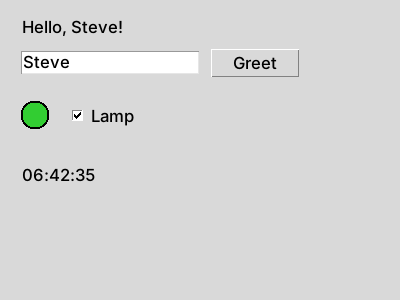

# 3. Your first panel

This chapter builds a small panel, step by step: a greeting, a clock, an indicator
lamp, and the Enter key. It takes about fifteen minutes and covers the whole
cycle: draw, set properties, write code, run.



## Part 1: Draw the form

1. **Start the designer** from your desktop shortcut, or from the Command Prompt:

   ```
   C:\dev\panelworks\.venv\Scripts\python -m panelworks.designer
   ```

   You get an empty form called **Form1** in the middle, the **Toolbox** on the left,
   and the **Properties** window on the right. The toolbar runs across the top,
   with the green **▶ Start** button.

2. **Name the form.** Click an empty spot on the form, so the Properties
   window shows **Form**. Click the **Name** row, type `Hello` in the box
   underneath, and press **Enter**. Then click **Caption**, type
   `My First Panel`, and press **Enter**.

3. **Draw a label.** Click **Label** in the Toolbox. Move to the form and
   **drag** a rectangle near the top, about 300 pixels wide. (Or just click once
   for a standard-size label.) It appears as `Label1`, selected, with a black
   grip at its bottom-right corner.

4. **Set its properties.** With `Label1` selected:
   - **Name** → `lblHello` (Enter)
   - **Caption** → `Type your name and press Greet` (Enter)

   Renaming as you go matters more than it seems. `lblHello` tells you what
   the control is (`lbl` = label) and what it's for. See *Naming* at the end
   of this chapter.

5. **Draw a text box** under the label. Name it `txtName`. Clear its
   **Text** property (select the row, delete the text, press Enter).

6. **Draw a button** to the right of the text box. Name it `cmdGreet`,
   Caption `Greet`.

7. **Save.** Press **Ctrl+S** (or the **Save** button). Make a folder for your
   panels, for example `C:\dev\mypanels`, and save as `Hello.json`.

To move a control, drag it. To resize, drag its black grip. The arrow keys nudge the
selected control by 1 pixel, or 10 with Shift held. **Ctrl+Z** undoes.

## Part 2: Write the code

8. **Double-click the Greet button.** The **Code window** opens with a new,
   empty event procedure, ready to type into:

   ```python
   def cmdGreet_Click(f):
       # runs when cmdGreet is clicked
       pass
   ```

   The word `pass` is selected, so whatever you type replaces it.

9. **Type the code:**

   ```python
   def cmdGreet_Click(f):
       # runs when cmdGreet is clicked
       f.lblHello.Caption = "Hello, " + f.txtName.Text + "!"
   ```

   `f` is the form. In VB this was `Me`. `f.lblHello.Caption` is the label's
   Caption property, and `f.txtName.Text` is whatever is typed in the box.

   Python uses **indentation** instead of `End Sub`. Everything indented under
   the `def` line belongs to the procedure. The Code window indents
   automatically after a line ending in `:`, and Tab inserts 4 spaces.

10. **Run it.** Click the green **▶ Start** button (or press **F5**). The
    designer saves the form and the code, then opens your panel in its own
    window. Type your name and click **Greet**.

11. Close the panel window, or click the red **■ End** button in the designer.

## Part 3: A clock (the Timer)

12. Back in the designer, draw another **Label** at the bottom of the form. Name it
    `lblClock`, Caption `--:--:--`, **FontSize** `16`, **FontBold** `True`.

13. Double-click **Timer** in the Toolbox. A Timer is invisible when the panel
    runs, so it sits in the tray under the form, as it did in VB. Set:
    - **Name** → `tmrClock`
    - **Interval** → `1000` (milliseconds, so once a second)
    - **Enabled** → `True` (choose it from the drop-down)

14. Double-click `tmrClock` in the tray. The Code window jumps to a new
    `tmrClock_Timer` procedure. Make it:

    ```python
    def tmrClock_Timer(f):
        # runs when tmrClock interval elapses
        f.lblClock.Caption = time.strftime("%H:%M:%S")
    ```

15. `time` is a Python module, so it has to be imported. Scroll to the
    **top** of the code (or pick **(General)** in the Object list) and add this
    line under the comments:

    ```python
    import time
    ```

16. **▶ Start.** The clock ticks.

## Part 4: A lamp (Shape and CheckBox)

17. Draw a **Shape** (it's a circle by default) and name it `shpLamp`. Set
    **FillColor** → `gray`.

18. Draw a **CheckBox** beside it: Name `chkLamp`, Caption `Lamp`.

19. Double-click the check box and write:

    ```python
    def chkLamp_Click(f):
        if f.chkLamp.Value == 1:
            f.shpLamp.FillColor = "lime green"
        else:
            f.shpLamp.FillColor = "gray"
    ```

    A CheckBox's `Value` is 1 when ticked and 0 when not, as in VB. Colours can be
    names (`red`, `lime green`, `dodger blue`, `orange`) or `#rrggbb` codes.

## Part 5: The Enter key (an event with an argument)

20. In the Code window, choose **txtName** in the **Object** list (top left)
    and **KeyPress** in the **Procedure** list (top right). A new procedure
    appears:

    ```python
    def txtName_KeyPress(f, key_ascii):
    ```

    `key_ascii` is the character code of the key, as in VB. Enter is 13.

21. Make it press the Greet button:

    ```python
    def txtName_KeyPress(f, key_ascii):
        if key_ascii == 13:
            f.cmdGreet.Click()
    ```

    `Click()` is a **method**: it presses the button from code, exactly as
    if the user had clicked it.

22. **▶ Start**, type a name, and press Enter.

Your finished code file `Hello.py`:

```python
# Event procedures for Hello.
# Name them Object_Event; each one receives the form as f,
# so f.Label1.Caption = "Hello" works like Me.Label1.Caption.
import time


def cmdGreet_Click(f):
    # runs when cmdGreet is clicked
    f.lblHello.Caption = "Hello, " + f.txtName.Text + "!"


def tmrClock_Timer(f):
    # runs when tmrClock interval elapses
    f.lblClock.Caption = time.strftime("%H:%M:%S")


def chkLamp_Click(f):
    if f.chkLamp.Value == 1:
        f.shpLamp.FillColor = "lime green"
    else:
        f.shpLamp.FillColor = "gray"


def txtName_KeyPress(f, key_ascii):
    if key_ascii == 13:
        f.cmdGreet.Click()
```

## If something goes wrong

- **A red line and a message when you save the code:** that's a syntax error,
  such as a missing `:` or `)` or wrong indentation. The message says what's
  wrong; fix that line and save again.
- **The status bar says "Panel error: ..." while the panel runs:** an
  event procedure raised an error. The panel keeps running; the message names
  the problem (for example `AttributeError: Form has no object or member 'lblHelo'`,
  which is a typo in a control name).
- **Nothing happens when you click:** check that the procedure name matches the
  control name exactly, including capitals: `cmdGreet_Click`, not `cmdgreet_click`.
  Renaming the control in the designer renames the procedure for you.

## Naming

VB programmers used three-letter prefixes, and they still help: you can
tell what a name is at a glance, and the Code window's lists sort nicely.

| Prefix | Control | Prefix | Control |
|---|---|---|---|
| `lbl` | Label | `lst` | ListBox |
| `cmd` | CommandButton | `cbo` | ComboBox |
| `txt` | TextBox | `shp` | Shape |
| `chk` | CheckBox | `pb` | ProgressBar |
| `opt` | OptionButton | `tmr` | Timer |
| `mqtt` | MQTT | `ser` | Serial |

Names must start with a letter and contain only letters, digits and `_`.
