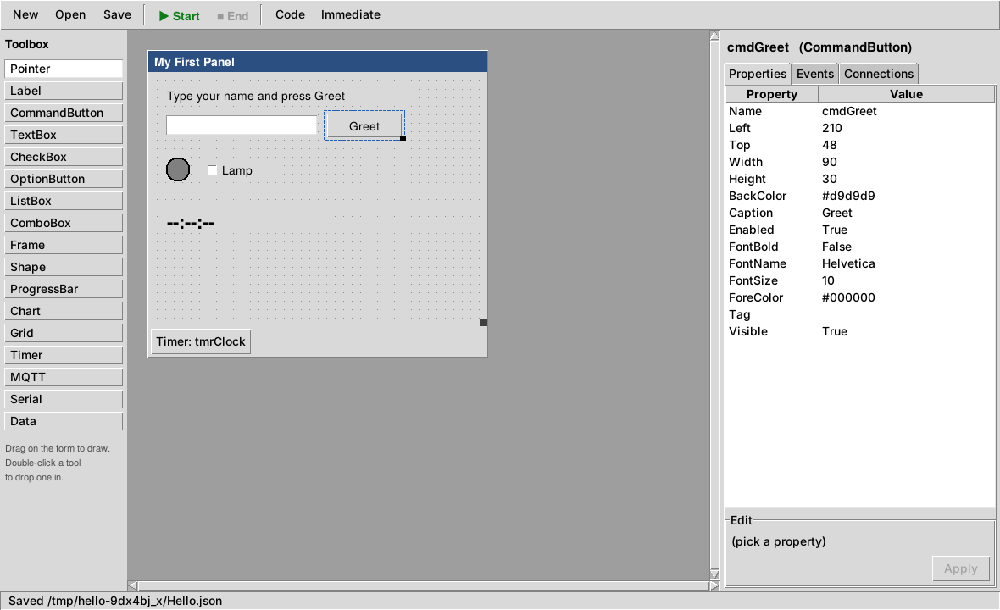
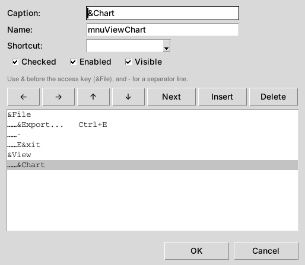
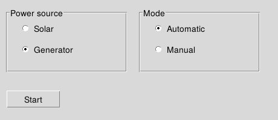
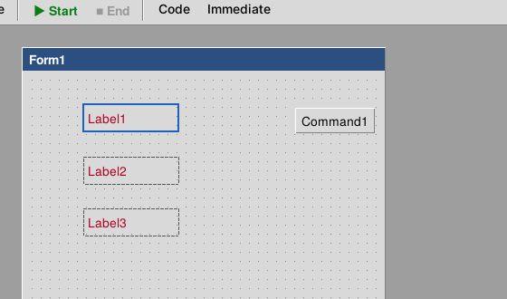
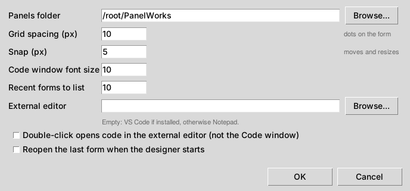

# 4. The Designer



The designer is laid out the way VB's was:

| Area | What it's for |
|---|---|
| **Menu bar** | File, Edit, View, Format, Tools, Help |
| **Toolbar** | New, Open, Save · **▶ Start**, **■ End** · Code, Immediate · ⬆ Update (when there is one) |
| **Toolbox** (left) | The controls you can draw |
| **Form** (middle) | Your window, on a grey workspace, with a dot grid |
| **Tray** (under the form) | Invisible controls: Timer, MQTT, Serial |
| **Properties / Events / Connections** (right) | Everything about the selected object |
| **Status bar** (bottom) | Mouse position, messages, errors from a running panel |

Start it with `panelworks-designer` (optionally followed by a form file), with
`panelworks --design MyPanel.json`, or from the desktop shortcut (chapter 2).

## Drawing controls

- **Drag:** click a tool in the Toolbox, then drag a rectangle on the form.
- **Click:** click a tool, then click the form for a standard-size control.
- **Double-click a tool** to drop one in at the top-left without aiming.

Invisible controls (Timer, MQTT, Serial) always go to the **tray** under the
form. Click a tray button to select the control; double-click it to open
its main event procedure.

After drawing, the tool goes back to **Pointer**, so the next click selects
instead of drawing again.

## Selecting, moving, sizing

- **Click** a control to select it. A dashed outline and a black **grip**
  (bottom-right) show the selection. Click the empty form to select the **Form**.
- **Drag** to move. Moves snap to 5 pixels so things line up.
- **Drag the grip** to resize. Drag the grip at the form's own bottom-right
  corner to resize the form.
- **Arrow keys** nudge 1 pixel; **Shift+arrows** nudge 10.
- **Del** deletes the selected control; **Ctrl+D** duplicates it.
- **Ctrl+C** and **Ctrl+V** copy and paste. Pasting a copy of a control on the same form
  asks whether to make a **control array** (`Lamp(0)`, `Lamp(1)`...), as VB did; see
  chapter 6.
- **Edit → Bring to front / Send to back** changes which control is on top
  where they overlap.
- **Ctrl+Z** undoes, up to 50 steps, including deletes, moves, renames and
  connection edits.

The mouse position (form coordinates) is shown in the status bar while you draw.

## Menus: the Menu Editor



**Tools → Menu Editor** (Ctrl+E) builds the panel's menu bar, the way VB's did:

1. Type a **Caption**. `&File` underlines the F (Alt+F opens it); `-` makes a
   separator line. A **Name** is suggested as you type (`mnuFile`, then
   `mnuFileExport` for an item under it); type your own to override.
2. Optionally pick a **Shortcut** (Ctrl+E, F5...) and tick **Checked**,
   **Enabled**, **Visible**, and **On phone** (untick for items like Exit that
   shouldn't be offered in the phone view, chapter 16).
3. **Next** adds an item below; **Insert** adds one above. **→** indents the item
   under the one above it (a submenu item), **←** takes it back out. **↑ ↓** move it.
4. **OK**. The menu shows as a strip at the top of the form; click it to edit again.

Each item has a **Click** event. Pick it in the Code window's Object and
Procedure lists (`mnuFileExit` → `Click`) and write what it does:

```python
def mnuFileExit_Click(f):
    f.Unload()

def mnuViewChart_Click(f):
    f.mnuViewChart.Checked = not f.mnuViewChart.Checked
    f.chtLevel.Visible = f.mnuViewChart.Checked
```

Renaming an item in the Menu Editor renames its procedure too. Menu items
have Caption, Checked, Enabled, Visible and Shortcut properties you can change at
run time (chapter 12).

## Frames



A **Frame** groups controls under a caption, as in VB. Draw the frame first, then
draw (or drag) controls inside it. A control belongs to a frame when it sits
entirely inside the frame's rectangle:

- moving the frame (drag, arrow keys, Format menu) carries its contents;
- OptionButtons inside a frame form **their own group**, so "Power source" and
  "Mode" above each keep one choice. Leave their Group as `default` for this;
- at run time, `f.fraMode.Visible = False` or `.Enabled = False` hides or disables
  the frame and everything in it.

Deleting a frame leaves its contents where they are (VB deleted them too; this
way nothing is lost by accident, and Ctrl+Z still works either way). To start a
selection box inside a frame, start the drag just outside it.

## Selecting several controls



- **Drag a box** on an empty part of the form: every control it touches is selected.
- **Ctrl+click** (or Shift+click) adds a control to the selection, or takes it out.
- **Ctrl+A** selects every control; **Esc** goes back to the Form.

The **primary** control, the last one you clicked, has a solid blue outline,
and the others are dashed. With several selected:

- dragging any of them moves them all, keeping their spacing; the arrow keys nudge them all;
- **Del** deletes them all, and **Ctrl+D** duplicates the group;
- the Properties window shows the primary's values, and **a change applies to
  every selected control that has that property**. Set ForeColor once for a whole
  row of labels.

### The Format menu

Line things up the way VB did. Everything aligns to the **primary** control:

| Format menu | Does |
|---|---|
| Align → Lefts, Centers, Rights | Line up the left edges, centres or right edges |
| Align → Tops, Middles, Bottoms | The same, vertically |
| Make Same Size → Width, Height, Both | Copy the primary's size |
| Horizontal / Vertical Spacing: Make Equal | Even gaps between three or more controls |
| Center in Form → Horizontally, Vertically | Centre the selection (one control or a group) |

A typical layout: draw a column of labels roughly, drag a box around them, click
the top one to make it primary, then **Align → Lefts** and **Vertical Spacing:
Make Equal**. Ctrl+Z undoes each step.

## The Properties window

Pick a row, then edit it in the **Edit** box under the list:

- **Text and numbers:** type, then press **Enter** or click **Apply**.
- **True/False and fixed choices** (Alignment, Shape, Terminator): pick from
  the drop-down; it applies at once.
- **Colours** (BackColor, ForeColor, FillColor...): type a name like
  `light yellow` or a code like `#ffcc00`, or click **Pick...** for a colour chooser.
- **Lists** (a ListBox's List, MQTT Subscriptions, Serial Fill): one item per
  line, then **Apply**.
- **Suggestions** (a Serial Port lists the ports present): pick one or type your own.

Grey rows are **read-only**. They show a value (ListCount, Connected, InBufferCount)
but can't be set at design time.

**Name** is special: renaming a control also renames its event procedures,
its references in your code, and any webhook fields that mention it. See
*Renaming* in chapter 5.

The **Form**'s properties are Name, Caption, Width, Height, BackColor, and
**Code**, the name of its code file (normally `<Name>.py`, set automatically
the first time you open the code).

## The Events tab

Lists every event the selected object has, for example `cmdStart_Click (is clicked)`.
A **●** marks the ones that already have code. Double-click an event to write
it (a new empty procedure is added) or jump to it in the Code window.

Double-clicking a control on the form does the same for its main event
(Click for a button, Change for a text box, Timer for a timer...).

## The Connections tab

Wires the selected object to MQTT and n8n, as JSON, with no code:

```json
{
  "subscribe": {"Caption": "home/cistern/level"},
  "publish":   {"Click": {"topic": "home/pump/cmd", "payload": "ON"}},
  "webhook":   {"Click": {"url": "pump-report", "send": ["lblLevel.Caption"]}}
}
```

Edit the text and click **Apply**. If the JSON has a mistake, a message
says where, and nothing changes. With the **Form** selected, this tab holds the
form-level `mqtt` (broker) and `webhooks` (n8n) settings. Chapters 8 and 10
explain every option.

## Running: ▶ Start and ■ End

**▶ Start** (or **F5**, or **File → Start**) saves the form and its code, then
runs the panel in its own window, exactly as it will run for real.

- While it runs, the button reads **▶ Restart**. Click it after making changes
  to close the running copy and start the new one.
- **■ End** stops the running panel. So does closing its window.
- If an event procedure raises an error, the panel keeps running and the
  status bar shows **Panel error: ...** with the message. **Ctrl+G** opens the
  Immediate window with the full details (chapter 6).
- If the panel can't start at all, a box shows the reason.

Unlike VB, the designer stays fully usable while the panel runs: you can keep
editing and press Restart.

**Closing the designer while a panel runs** asks whether to stop it too:
**Yes** stops it, **No** leaves it running on its own (handy for a monitoring
console you want to keep up), **Cancel** keeps the designer open. A panel left
running is fully independent. Its output goes to a log file in your temp
folder (`panelworks-run-<form>.log`), not to the designer.

## Make EXE: a program to hand to someone

**File → Make EXE...** packages the panel as one program that runs without
Python or PanelWorks installed, like VB's *Make Project.exe*.

1. Save the panel. Everything in its folder that belongs to it goes in: every
   form (`.json`) and code file (`.py`), so `f.Show("Settings")` still works, and
   folders named after a form (such as an Arduino sketch). The modules your code
   imports are found and included.
2. Give the program a name and click **Build**. The first build installs
   PyInstaller (the packaging tool) and takes a minute or two.
3. The program is in a `dist` folder beside your form: `dist\MyPanel.exe`, about
   15 MB. **Open folder** shows it.

Copy it to another PC and double-click it. Files the program writes (a Data
control's database, CSV exports) go **beside the program**, so keep it in a
folder the user can write to (Documents, the desktop), not Program Files.

Things to know:

- **It runs on the kind of computer it was built on.** Build on Windows for
  Windows; on a Raspberry Pi for a Raspberry Pi.
- **Tick "Keep a console window"** for test builds: `print()` output and errors
  show there. Leave it unticked for the real thing.
- **Windows will warn about it on other PCs** (chapter 14): it isn't code-signed.
  "Windows protected your PC" → **More info** → **Run anyway** gets past
  SmartScreen. On PCs with Smart App Control turned on, an unsigned program is
  blocked outright, and the only fix is signing it.
- **Signing**, if you'll distribute it: Microsoft's **Azure Artifact Signing**
  (formerly Trusted Signing) is the cheapest route, about $10 a month, with
  identity checks; individual developers in the USA and Canada qualify. A
  traditional OV certificate from a certificate authority runs about $150–300 a
  year. Either way, SmartScreen trust builds up as more people run the program.
- Claude can't connect to a built program (it has no MCP server). Panels you run
  with PanelWorks itself keep everything.

The same thing from a Command Prompt:
`python -m panelworks.make_exe MyPanel.json --name MyPanel`.

## Files: New, Open, Save

- **New** (Ctrl+N) starts an empty form.
- **Open** (Ctrl+O) opens a `.json` form.
- **File → Panels** lists the forms in your **panels folder** (and its
  subfolders), with **Open panels folder** to show it in Explorer.
- **File → Examples** lists the bundled example panels. Choosing one opens a
  **copy** in your panels folder, with its code and any Arduino sketch that goes
  with it, so you can change it freely while the original stays clean for
  `git pull`. If you already have a copy, you're asked whether to open yours or
  replace it with a fresh one.
- **File → Open Recent** lists the last 10 forms you opened or saved, newest
  first, with their folders. A form that has been moved or deleted is greyed out
  and marked *(missing)*. **Clear Recently Opened** empties the list. The list is
  shared by every designer window and kept in `%APPDATA%\PanelWorks\recent.json`
  (`~/.config/panelworks/` on macOS and Linux).
- **Save** (Ctrl+S) saves the form, **and the code if the Code window has unsaved
  changes**. The title bar shows `*` while there are unsaved changes.
- **Close** (Ctrl+W) closes the form (asking to save first if needed) and leaves
  an empty designer, without quitting.
- **Save As...** saves under a new name or folder. The link to the code file
  is adjusted so it's still found.
- **File → Reload from disk** throws away your changes and reloads the file.

The form file only stores properties you changed from their defaults, so it
stays short and readable. Chapter 7 describes the format.

### Working alongside Claude or another editor

The designer watches the form it has open. If the file changes on disk (Claude
saved the form, you edited it in VS Code, `git pull` updated it) the designer
reloads it. If you have unsaved changes, it asks first. The Code window does the
same for the `.py` file.

So you can rough out a panel by talking to Claude, then polish it by hand, or the
other way round.

## Preferences



**File → Preferences** (Ctrl+,):

| Setting | Default | Does |
|---|---|---|
| Panels folder | `Documents\PanelWorks` | Where Save As, Open, File → Panels and File → Examples copies go |
| Grid spacing | 10 px | The dots on the form |
| Snap | 5 px | Moves and resizes jump in these steps |
| Code window font size | 11 (Windows) | Applies at once, including an open Code window |
| Recent forms to list | 10 | Length of File → Open Recent |
| External editor | (empty) | Program for **External...**; empty means VS Code if installed, else Notepad |
| Double-click opens code in the external editor | off | Use your own editor instead of the Code window |
| Reopen the last form at startup | off | The designer opens where you left off |
| Check GitHub for a newer PanelWorks once a day | on | Shows the ⬆ Update button when there is one |

Settings are kept in `%APPDATA%\PanelWorks\settings.json` (`~/.config/panelworks/`
on macOS and Linux), so they survive updates. The `PANELWORKS_EDITOR` environment
variable, if set, still overrides the editor setting.

## Keyboard shortcuts

| Key | Does |
|---|---|
| F5 | Start (save and run) |
| F7 | Code window |
| Ctrl+G | Immediate window |
| Ctrl+N / Ctrl+O / Ctrl+S | New / Open / Save |
| Ctrl+W | Close the form |
| Ctrl+, | Preferences |
| Ctrl+E | Menu Editor |
| Ctrl+Z | Undo |
| Ctrl+C / Ctrl+V | Copy / paste the selected control(s); pasting beside the original offers a control array |
| Ctrl+D | Duplicate the selected control(s) |
| Del | Delete the selected control(s) |
| Ctrl+A | Select all controls |
| Esc | Select the Form |
| Ctrl+click / Shift+click | Add to or remove from the selection |
| Arrows / Shift+arrows | Nudge 1 / 10 pixels |

## Help

- **Check for Updates...** compares your copy with GitHub and lists what's new,
  with **Update now** (chapter 2, *Updating*).
- **About** shows the version, the author, and the licence.
