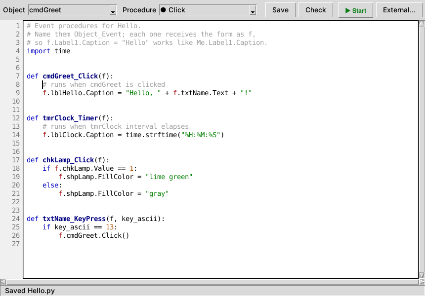

# 5. The Code window

The Code window edits the form's `.py` file, the way VB's code window edited
the code behind a form. Open it with **F7**, the **Code** toolbar button,
**View → Code**, or by double-clicking a control or an event.

It's a separate window, so you can keep the designer and the code side by side
and use both, switching freely.

## Object and Procedure lists

The two lists at the top work as they did in VB:

1. Pick an **Object**: a control, `Form`, or `(General)`.
2. Pick a **Procedure**: one of that object's events.

If the procedure exists, the cursor jumps to it. If not, an empty one is added at
the end of the file, with the right arguments and `pass` selected so you can
type straight over it.

- A **●** in the Procedure list marks events that already have code.
- The lists **follow the cursor**: click inside any procedure and they show
  which one you're in.
- `(General)` lists your own helper functions (anything that isn't an event
  procedure). `import` lines and shared variables go at the top of the
  file, above the procedures: VB's "(Declarations)" section.

## Editing

- Python colouring: keywords, strings, comments, numbers, and `f.` references.
- Line numbers down the left.
- **Tab** inserts 4 spaces; **Shift+Tab** un-indents. Select several lines and
  press Tab or Shift+Tab to indent or un-indent them all.
- **Enter** keeps the indentation, adds a level after a line ending in `:`, and
  drops one after `pass`, `return`, `break` or `continue`.
- **Ctrl+Z / Ctrl+Y** undo and redo.
- **Ctrl+F** finds; **F3** finds the next match.

## Saving and the syntax check

**Ctrl+S** (or the **Save** button) checks the code before saving. If there's
a syntax error (a missing `:`, an unclosed bracket, wrong indentation), the
line is marked in red, the message says what's wrong, and **nothing is
saved**. A half-typed procedure can never stop a panel from starting.

**Check** runs the same test without saving.

The title shows `*` while there are unsaved changes. **Ctrl+S in the
designer** also saves the code, and **▶ Start** saves both before running.

## ▶ Start

The Code window has its own green **Start** button (and **F5**). It saves the
code and the form, then runs the panel.

## External editor

**External...** opens the file in VS Code if it's installed, otherwise Notepad
(Windows), TextEdit (macOS) or your `$EDITOR`. To always use your own editor
when double-clicking controls, set the environment variable
`PANELWORKS_EDITOR` to its path, for example
`C:\Program Files\Notepad++\notepad++.exe`.

If the `.py` file changes on disk while the Code window is open (another editor,
Claude, `git pull`) and you have no unsaved changes, it reloads. If you
do, it warns you before your save would overwrite the other change.

## Renaming keeps your code in step

In VB, renaming `Command1` to `cmdStart` orphaned `Command1_Click` in
(General), and you had to fix it by hand. PanelWorks does it for you. Rename
`Text1` to `txtName` in the Properties window, and:

| Before | After |
|---|---|
| `def Text1_Change(f):` | `def txtName_Change(f):` |
| `f.Text1.Text` | `f.txtName.Text` |
| `f["Text1"]`, `f.obj("Text1")` | `f["txtName"]`, `f.obj("txtName")` |
| webhook `"send": ["Text1.Text"]` | `"send": ["txtName.Text"]` |

Only whole names are changed: `Text10`, `Text1_helper` (not an event) and
`other.Text1` (not the form) are left alone. The Code window opens to show
the result, unsaved, and the status bar says how many procedures and
references changed. **Ctrl+S** in the designer saves both files;
**Ctrl+Z** undoes the rename in the form **and** the code together.

## Where the code file lives

The code file sits next to the form: `Hello.json` and `Hello.py`. It's
created the first time you open the code (the form must be saved first, so it
has a folder). The form's **Code** property holds its name. You can point two
forms at the same code file, though it's rarely useful.
