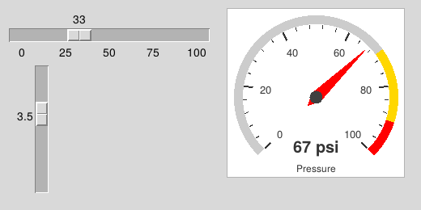
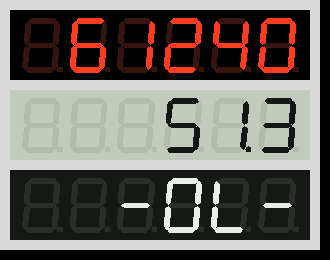
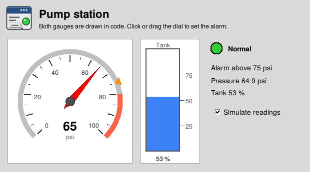
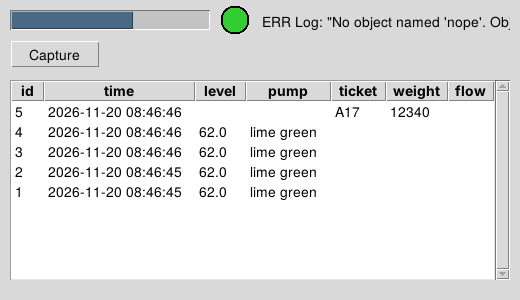
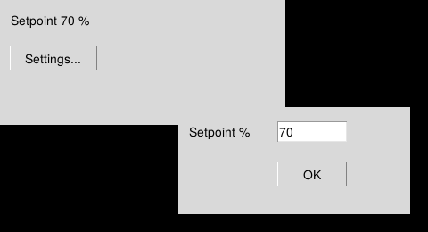
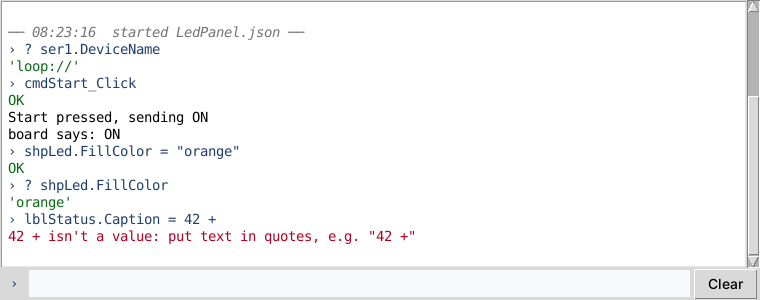

# 6. Programming

The code behind a form is an ordinary Python file. PanelWorks loads it when
the panel starts and calls its functions when events happen. This chapter covers
everything you need to write that code. You don't need to know Python well to
start; the patterns here cover most panels.

## Event procedures

An event procedure is a function named **`Object_Event`**:

```python
def cmdStart_Click(f):
    f.lblStatus.Caption = "Running"
```

- **`Object`** is the control's Name, exactly (capitals matter).
- **`Event`** is one of that control's events (chapter 12 lists them all).
- The first argument, **`f`**, is the form, like VB's `Me`. Through it you reach
  every control.
- Some events pass more arguments after `f`:

| Event | Procedure |
|---|---|
| TextBox KeyPress | `def txtName_KeyPress(f, key_ascii):` |
| Serial DataArrival | `def ser1_DataArrival(f, line):` |
| MQTT MessageArrived | `def mqtt1_MessageArrived(f, topic, payload, retained):` |
| any Error | `def ser1_Error(f, message):` |
| WebhookResponse | `def cmdAsk_WebhookResponse(f, data):` |

You may leave arguments off the end if you don't need them:
`def ser1_DataArrival(f):` is fine. The easiest way to get them right is to let
the designer write the first line for you (double-click, or pick from the
Code window's lists).

### The form's own events

```python
def Form_Load(f):
    # runs once, after every control is built, before the user can do anything
    f.txtSetpoint.Text = "85"
    f.lstLog.AddItem("Panel started")

def Form_Unload(f):
    # runs as the window closes: save settings, switch things off
    pass
```

Properties set in the designer are applied **before** any events fire, so
building the form never triggers your procedures. Events start with `Form_Load`.

## Properties: reading and setting

Everything is done with properties. Read one by naming it; set it with `=`.

```python
level = f.barLevel.Value              # read
f.barLevel.Value = level + 5          # set
f.lblLevel.Caption = f"{level} %"     # set from an expression
f.cmdStop.Enabled = False             # True/False
f.shpPump.FillColor = "lime green"    # colours by name or "#rrggbb"
f.Caption = "Pump Panel - running"    # the form's own properties: f.Caption, f.BackColor
```

Some properties fire events when set from code, as in VB: setting a TextBox's
`Text` fires its `Change`, and setting a CheckBox's `Value` fires its `Click`.
Keep that in mind if a procedure sets the property of the control whose event
it is handling.

## Methods: doing things

Methods are called with brackets:

```python
f.lstLog.AddItem("Pump on")           # add to the end
f.lstLog.AddItem("Newest", 0)         # add at the top
f.lstLog.RemoveItem(0)
f.lstLog.Clear()
f.cmdStart.Click()                    # press a button from code
f.txtName.SetFocus()
f.MsgBox("Tank is full", "Warning")   # pop-up message, waits for OK
f.Unload()                            # close the panel (VB's Unload Me / End)
```

## Text, numbers and formatting

Properties like `Caption` and `Text` are text. Convert before doing arithmetic:

```python
setpoint = int(f.txtSetpoint.Text)          # "85" -> 85     (VB: CInt / Val)
volts = float(f.txtVolts.Text)              # "12.6" -> 12.6
f.lblTotal.Caption = str(a + b)             # number -> text (VB: CStr)
f.lblTemp.Caption = f"{temp:.1f} °C"         # f-string: 1 decimal place
f.lblFlow.Caption = f"{flow:,.0f} gal"       # thousands separator
```

Check text before converting, or the conversion raises an error:

```python
t = f.txtSetpoint.Text.strip()
if t.isdigit():
    setpoint = int(t)
```

Or catch the error (VB's `On Error`):

```python
try:
    volts = float(f.txtVolts.Text)
except ValueError:
    f.lblStatus.Caption = "Enter a number"
    return
```

## Remembering things between events (form-level variables)

Variables made inside a procedure vanish when it ends. To keep a value between
events (VB's form-level `Dim`), create it at the top of the file and declare
it `global` in any procedure that **changes** it:

```python
import time

pump_on = False          # form-level: survives between events
starts = 0


def cmdStart_Click(f):
    global pump_on, starts
    pump_on = True
    starts += 1
    f.lblStarts.Caption = f"Starts today: {starts}"


def tmrPoll_Timer(f):
    if pump_on:          # reading needs no 'global'
        f.barLevel.Value -= 1
```

## Helper procedures

Write your own functions for anything you do in more than one place. They appear
under `(General)` in the Code window. Pass `f` along if they touch controls:

```python
def log(f, text):
    f.lstLog.AddItem(time.strftime("%H:%M:%S  ") + text, 0)   # newest on top
    if f.lstLog.ListCount > 50:
        f.lstLog.RemoveItem(50)


def cmdStart_Click(f):
    log(f, "Pump started")
```

## Charts

A **Chart** plots readings over time. Setting its `Value` adds a point:

```python
def ser1_DataArrival(f, line):
    f.chtVolts.Value = float(line)          # one line per reading

def tmrPoll_Timer(f):
    f.chtRoom.AddPoint(read_temp(), "Temp")  # by series name
    f.chtRoom.AddPoint(read_rh(), "RH")
```

Set **Series** (one name per line) for several lines, **Window** for how many
seconds to show, and **AutoScale** off with **YMin**/**YMax** for a fixed scale
(a tank 0–100 %). Often you need no code at all: subscribe the Chart's `Value`
to an MQTT topic, or point a Serial **Fill** line at it.


## Sliders and gauges

A **Slider** sets a value by dragging; a **Gauge** shows one on a dial.

```python
def sldSpeed_Scroll(f):                       # while it's being dragged
    f.lblSpeed.Caption = f"{f.sldSpeed.Value} %"

def sldSpeed_Change(f):                       # when it's let go (or code sets Value)
    f.mqtt1.Publish("pump/speed", f.sldSpeed.Value)

def tmrPoll_Timer(f):
    f.gauPressure.Value = read_pressure()      # the needle moves
```

Slider: **Min**, **Max**, **Value**, **SmallChange** (the step: 1 for whole numbers,
0.5 for halves), **TickFrequency** (numbers along the scale) and **Orientation**
(Horizontal or Vertical). Setting Value from code fires Change, as in VB, so if
Change writes to a device, use a flag when you're only showing the device's own value.
The power meter example (chapter 17) shows how.

Gauge: **Min**, **Max**, **Value**, **Units**, **Title**, and **Zones**, one per line
as `from to colour` (`80 90 gold`, `90 100 red`). Like a Chart, a Gauge needs no code
when its Value is subscribed to an MQTT topic or filled from Serial, Modbus or SNMP.
Set **Interactive** to True and the needle can be dragged, which makes it a knob:
Scroll fires while it turns and Change when it's let go.



## Digital readouts (SegmentDisplay)

A **SegmentDisplay** shows a number the way a scale head, a meter or a clock does,
in seven-segment digits. Pick its **Style**:

- **LED**: lit red segments on black (change **OnColor** for green, amber or blue);
- **LCD**: black segments on a grey panel, the unlit ones faintly visible;
- **LCD Reverse**: light segments on a dark panel, like a backlit display.



```python
f.segWeight.Value = 61240          # a number...
f.segVolts.Value = "51.27"         # ...or numeric text from a device (Decimals 1 shows 51.3)
f.segWeight.Value = "-OL-"         # ...or short text: Err, OL, HELLO
```

**Digits** is how many positions it has; the decimal point rides on a digit and
doesn't take one. A value that doesn't fit shows dashes in every position, so it can
never show a wrong number. **Decimals** fixes the places (-1 shows as many as fit),
**LeadingZeros** pads with zeros, and **Alignment** is Right, Left or Center. Like a
Gauge, it needs no code when MQTT, Serial, Modbus or SNMP fills its Value. The truck
scale example (chapter 13) uses one for the weight.

## Pictures and drawing (PictureBox)

A **PictureBox** shows a picture and is a surface you draw on from code, as in VB.
Use it for anything the stock controls don't cover: a round gauge, a compass rose,
a schematic of tanks and pipes, a logo.

**A picture:** set **Picture** to a file beside the form, such as `img/plant.png`. The
designer's Browse button keeps the path relative, so the panel can move. PNG and GIF
always work; JPEG needs Pillow (`pip install pillow`). **AutoSize** fits the box to the
picture, **Stretch** scales the picture to the box, and BorderStyle 0 removes the border.

**Drawing:**

```python
def tmrPoll_Timer(f):
    p = f.picTank
    p.Cls()                                               # start over
    p.Line(10, 10, 60, 110, "gray30", box=True, width=2)  # the tank (a box)
    p.Line(10, 110 - level, 60, 110, box=True, fill="#3b82f6")   # the water, filled
    p.Circle(100, 40, 20, "red", fill=True)               # a lamp
    p.Circle(100, 40, 30, "gray", start=0, end=180)       # an arc, in degrees
    p.Polygon([(90, 80), (110, 80), (100, 60)], "black", fill="yellow")
    p.PSet(5, 5, "green")                                 # one point
    p.Print(f"{level} %", 35, 120, anchor="n")            # text under (35, 120)
```

Colours are names or `#rrggbb`. Leave the colour out and **ForeColor** is used;
**FillColor** and **DrawWidth** give the defaults for fills and line thickness. Drawings
are kept and redrawn when the box is resized. They're live output and are never saved in
the form; **Cls** clears them, and the Picture stays.

**Your own units.** Positions are pixels from the top-left until you set a scale.
`f.picGauge.Scale(-100, 100, 100, -100)` makes the box run from -100 to 100 both ways
with y pointing **up**, so (0, 0) is the centre. A dial can then use plain trigonometry:

```python
import math

def needle(f, value):                    # 0..100 across a 270-degree dial
    a = math.radians(225 - 2.7 * value)
    p = f.picGauge
    p.Cls()
    p.Circle(0, 0, 90, "gray75", start=-45, end=225, width=8)
    p.Line(0, 0, 80 * math.cos(a), 80 * math.sin(a), "red", width=3)
    p.Print(f"{value:.0f}", 0, -40, anchor="center")
```

The same settings are the **ScaleLeft/ScaleTop/ScaleWidth/ScaleHeight** properties, so
you can set them in the designer instead. Circle angles are degrees, 0 at 3 o'clock,
counter-clockwise, which matches sin/cos when y points up.

**Mouse.** Click, DblClick, MouseDown, MouseUp and MouseMove all receive `x, y` in the
box's own units, so you can draw knobs and sliders. MouseMove fires while the button is
held, i.e. during a drag:

```python
def picGauge_MouseMove(f, x, y):
    f.lblAngle.Caption = f"{math.degrees(math.atan2(y, x)):.0f} degrees"
```

**Text:** `Print(text, x, y)` writes at (x, y), or at **CurrentX**/**CurrentY** when you
leave them out. Each Print moves CurrentY down a line, so a run of Prints makes a list.
`anchor` says which part of the text sits at (x, y): `nw` (top-left, the default), `center`,
`n`, `s`, `e`, `w`, `ne`, `se` or `sw`. The box's FontName/FontSize/FontBold are used; change
them between Prints for big and small text.

**More pictures:** `PaintPicture("img/valve.png", x, y, width, height)` draws a picture
file anywhere in the box, so a schematic can show valve icons on top of a background.

The PictureBox works in the phone view too, where a tap fires Click with x, y.
**Make EXE** packages the Picture files named in your forms. Put pictures your code
draws with PaintPicture in the folder named after the form (`gauges/` for
`gauges.json`), which is packaged whole. `examples/gauges.*` has all of this working.



## Timers

A Timer fires its `Timer` event every `Interval` milliseconds while `Enabled`
is True. Use it for anything periodic: polling, animation, timeouts, clocks.

```python
def tmrPoll_Timer(f):
    f.lblClock.Caption = time.strftime("%H:%M:%S")

def cmdAuto_Click(f):
    f.tmrPoll.Interval = 5000
    f.tmrPoll.Enabled = True      # start
    # f.tmrPoll.Enabled = False   # stop
```

A one-shot delay: enable the timer, and disable it in its own event.

```python
def cmdPrime_Click(f):
    f.shpValve.FillColor = "orange"
    f.tmrPrime.Interval = 3000
    f.tmrPrime.Enabled = True

def tmrPrime_Timer(f):
    f.tmrPrime.Enabled = False     # only once
    f.shpValve.FillColor = "gray"
```

## Don't freeze the window

While an event procedure runs, the window can't redraw or respond, the same
as in VB. Keep procedures quick. In particular:

- **Never `time.sleep()` in an event procedure.** Use a Timer for delays.
- **Never loop waiting** for something to happen. Let its event tell you
  (DataArrival, MessageArrived, a Timer tick).
- For **slow work** (a big download, a slow calculation), run it on a
  background thread. Don't touch controls from that thread; hand the result back
  with `f.post(function, args...)`, which runs it on the window's thread:

```python
import threading, urllib.request

def show_weather(f, text):
    f.lblWeather.Caption = text            # runs on the window's thread: safe

def cmdWeather_Click(f):
    f.lblWeather.Caption = "Fetching..."
    def work():
        text = urllib.request.urlopen("https://wttr.in/?format=3", timeout=10).read().decode()
        f.post(show_weather, f, text)       # hand back to the window
    threading.Thread(target=work, daemon=True).start()
```

PanelWorks's own connections (Serial, MQTT, webhooks) already work this way.
Their events always arrive on the window's thread, so you never need
`f.post` for them.

## Control arrays

Eight zone lamps, sixteen relay buttons: a **control array** is a row of controls
that share a name and one set of event procedures, told apart by their **Index**,
exactly as in VB. The elements are called `Lamp(0)`, `Lamp(1)`, `Lamp(2)`...

**Making one in the designer**, the VB way:

1. Draw a Shape and name it `Lamp`.
2. Select it, press **Ctrl+C**, then **Ctrl+V**.
3. PanelWorks asks *"You already have a control named 'Lamp'. Do you want to create a
   control array?"* Click **Yes**. The first one becomes `Lamp(0)`, the copy `Lamp(1)`.
4. Press **Ctrl+V** again for `Lamp(2)`, `Lamp(3)`... no more questions. **Ctrl+D**
   (Duplicate) on an element adds the next one too.

Or set a control's **Index** property to `0` to start an array, and give the next
control the same name with Index `1`. Clear Index to make an element a single
control again. If the control already had procedures, making it an array gives them
the `index` argument and changes `f.Lamp.` to `f.Lamp(0).` in your code.

**One procedure for all of them.** The Code window lists the array once, as `Lamp`.
Its procedures get the element's index first, then the event's usual arguments:

```python
def Lamp_Click(f, index):
    f.Lamp(index).FillColor = "red" if f.Lamp(index).FillColor != "red" else "gray"
    f.lblStatus.Caption = f"Zone {index + 1} toggled"

def txtSet_KeyPress(f, index, key_ascii):    # a TextBox array
    ...
```

**In code**, `f.Lamp` is the whole array:

| Code | Means |
|---|---|
| `f.Lamp(3)` or `f.Lamp[3]` | element 3 |
| `for lamp in f.Lamp:` | every element, in index order |
| `len(f.Lamp)`, `f.Lamp.Count` | how many |
| `f.Lamp.LBound`, `f.Lamp.UBound` | lowest and highest index |
| `f.Lamp.Indexes` | the indexes in use, e.g. `[0, 1, 2, 7]` (gaps are allowed) |
| `f.Lamp(3).Index` | 3 |

```python
def set_zones(f, states):            # states: [True, False, True, ...]
    for lamp, on in zip(f.Lamp, states):
        lamp.FillColor = "lime green" if on else "gray"
```

**Adding elements while the panel runs**, like VB's `Load Lamp(8)`:

```python
lamp = f.Lamp.Load(8)          # a copy of the lowest element, hidden
lamp.Left = f.Lamp(7).Left + 40
lamp.Visible = True
...
f.Lamp.Unload(8)               # remove it again
```

Only elements made with `Load` can be unloaded; hide a designer-drawn one with
`Visible = False`. Elements made with `Load` fire the same `Lamp_Click`.

Everywhere else an element is named like that too: `Lamp(3).FillColor` in Fill lines,
alarm rules, webhook `send` lists and the Immediate window, and `Lamp(3)` in MCP,
MQTT and the form file.

## Reaching controls by name

`f["name"]` reaches a control by a name built at run time:

```python
def clear_box(f, n):
    f[f"txtLine{n}"].Text = ""
```

`f.objects` is a dictionary of every control, so you can loop over them all:

```python
for name, ctl in f.objects.items():
    if ctl.Type == "TextBox":
        ctl.Text = ""
```

You can also add and remove controls while the panel runs:

```python
f.add_object("lblExtra", "Label", {"Caption": "Added at run time", "Left": 10, "Top": 200})
f.remove_object("lblExtra")
```

## Using Python's libraries

Everything in Python's standard library is available. Put `import` lines at the
top of the file. A few that suit panels:

```python
import time, datetime        # clocks, timestamps
import math, statistics      # sums, averages
import csv, json, sqlite3    # logging and storage
import os, subprocess        # files, running other programs
import urllib.request        # fetching web pages and APIs
```

Log readings to a CSV file that opens in Excel or LibreOffice:

```python
import csv, time

def ser1_DataArrival(f, line):
    with open("readings.csv", "a", newline="") as fh:
        csv.writer(fh).writerow([time.strftime("%Y-%m-%d %H:%M:%S"), line])
```

Libraries installed with pip into the PanelWorks venv work too:
`C:\dev\panelworks\.venv\Scripts\python -m pip install requests`.

## Asking the user questions

`f.MsgBox` shows a message. For yes/no questions and typed input, use
Tkinter's dialogs and pass `parent=f.root` so they appear over your panel:

```python
from tkinter import messagebox, simpledialog

def cmdReset_Click(f):
    if messagebox.askyesno("Reset", "Clear the run hours?", parent=f.root):
        f.lblHours.Caption = "0"

def cmdName_Click(f):
    name = simpledialog.askstring("Name", "Panel name:", parent=f.root)
    if name:
        f.Caption = name
```

## Logging to a database (Data and Grid)

A **Data** control (it sits in the tray) is a SQLite database file beside your
form, `<form>.db` unless you set DatabaseName. Tell it what a row holds, and
how often, in **LogFields** and **LogEvery**:

```
level = barLevel.Value
pump = shpPump.FillColor
temp = lblTemp.Caption
```

With LogEvery = 60, it logs a row a minute, with a timestamp, and no code. The
columns are created for you, and adding a line later just adds a column.
Numbers are stored as numbers. Draw a **Grid**, set its **DataSource** to the
Data control, and it shows the newest rows, updating as they're logged.



For weeks of history on Grafana dashboards, the **InfluxDB** control logs the same
way to an InfluxDB server (chapter 20).

In code:

```python
def cmdCapture_Click(f):
    f.datLog.Log()                                   # log the LogFields now

def cmdTicket_Click(f):
    f.datTickets.Log({"ticket": f.txtTicket.Text,    # or your own values
                      "gross": gross, "tare": tare, "net": gross - tare})

def datLog_Logged(f, row):
    f.lblLast.Caption = f"Logged #{row['id']} at {row['time']}"

def cmdExport_Click(f):
    path = f.datLog.ExportCSV()                      # opens in Excel / LibreOffice
    f.MsgBox(f"Saved {path}")

def cmdToday_Click(f):
    rows = f.datLog.Query("SELECT AVG(level) AS avg FROM log WHERE time >= date('now','localtime')")
    f.lblAvg.Caption = f"Average today: {rows[0]['avg']:.1f} %"
```

**RecordSource** is the query a bound Grid shows (default: newest 100 rows).
Set it to anything, e.g. `SELECT time, level FROM log WHERE level < 20 ORDER BY id DESC`.
The `.db` file opens in any SQLite tool (DB Browser for SQLite is free), and
n8n's SQLite node can read it too.

A Grid can also be filled from code: set **Columns**, then `AddRow(...)`, `Clear()`,
`Rows = [[...], [...]]`; read `Row`, `Text` and `Cell(row, column)`.

## Several forms (dialogs)

A program can have more than one form, like VB. Make each one in the designer
and save them in the same folder. `Settings.json` beside `Pump.json`, say. Then:

```python
# Pump.py, the main form
def cmdSettings_Click(f):
    f.Show("Settings", modal=True)       # waits here until the dialog closes
    f.lblStatus.Caption = "Settings saved"

def cmdLog_Click(f):
    f.Show("LogViewer")                  # modeless: both windows stay usable
```

```python
# Settings.py, the dialog
def Form_Load(f):
    f.txtSetpoint.Text = f.Owner.lblSet.Caption.split()[1]   # read the main form

def cmdOK_Click(f):
    f.Owner.lblSet.Caption = f"Setpoint {f.txtSetpoint.Text} %"
    f.Unload()

def cmdCancel_Click(f):
    f.Unload()
```



- `f.Show("Name")` finds `Name.json` next to the current form (or a form whose
  name is `Name`), runs its Form_Load, and returns it. Showing a form that's
  already open just brings it to the front: each form has one copy, as in VB.
- `modal=True` makes the caller wait, and keeps the user in the dialog until it closes.
- `f.Owner` is the form that showed this one; `f.Main` is the first form;
  `f.Forms["Name"]` reaches any open form's controls.
- `f.Hide()` hides a form and keeps everything in it; `Show` brings it back.
  `f.Unload()` closes it. Closing the main form closes them all.
- Each form has its own code file, and its own MQTT and webhook settings.
  Claude's MCP tools see the main form.

## Saving settings between runs

A small JSON file in the panel's folder is the simplest way. `f.AppPath` is that
folder, like VB's `App.Path`:

```python
import json, os

def settings_file(f):
    return os.path.join(f.AppPath, "settings.json")

def Form_Load(f):
    if os.path.exists(settings_file(f)):
        s = json.load(open(settings_file(f)))
        f.txtSetpoint.Text = s.get("setpoint", "85")

def Form_Unload(f):
    json.dump({"setpoint": f.txtSetpoint.Text}, open(settings_file(f), "w"))
```

`AppPath` is the form file's folder while you work on the panel, and the program's
own folder once you build it with **File → Make EXE** (chapter 4). Don't use
`os.path.dirname(__file__)` for this: in a built program that's a temporary folder
that disappears when the program closes, taking your settings with it. The Data
control already keeps its database in `AppPath`.

## When something goes wrong

**Syntax errors** are caught when you save in the Code window (chapter 5).

**Run-time errors**, such as a misspelt control name, text that isn't a number,
or a file that isn't there, stop that one procedure. The panel carries on, and:

- the designer's status bar shows **Panel error:** and the message, when you
  started it with ▶ Start;
- the full details (the *traceback*, ending with the line number) are printed
  to the console, when you started it from a Command Prompt;
- Claude sees the error attached to the event, if it's connected (chapter 11).

Reading a traceback: the **last line** says what went wrong; the line
above it that names your `.py` file says where.

```
  File "C:\Users\you\Documents\PanelWorks\Hello.py", line 9, in cmdGreet_Click
    f.lblHelo.Caption = "Hello"
AttributeError: Form has no object or member 'lblHelo'
```

**Debugging with print**: `print(...)` is PanelWorks' `Debug.Print`. Its output
appears in the **Immediate window** (below) when you run with ▶ Start, or in the
console when you run a panel from a Command Prompt.

## The Immediate window



**View → Immediate Window**, **Ctrl+G** (as in VB), or the **Immediate** toolbar
button. While a panel runs it shows, live:

- everything your code `print()`s,
- errors, in red, with the traceback (the last red line says what went wrong,
  and the line naming your `.py` file says where),
- messages from PanelWorks itself (`[mqtt] ...`, `[serial] ...`, `[webhook] ...`), in grey.

You can also type at the running panel, VB-style, and press Enter:

| Type | Does |
|---|---|
| `? lblStatus.Caption` | Show a property (`print f.lblStatus.Caption` works too) |
| `? lblStatus` | Show every property of a control |
| `lblStatus.Caption = "Hello"` | Set a property. Values are Python literals: `42`, `3.5`, `True`, `"text"`, `["a", "b"]` |
| `lstLog.AddItem("x", 0)` | Call a method |
| `cmdStart_Click` | Fire an event, as if it happened |
| `cls` | Clear the window |
| Up / Down | Previous lines |

This is the quickest way to try things: poke a property, fire an event, and see
what your code prints, without editing anything. Typed lines go through the same
safe channel Claude uses, so they can only read and set properties, call methods
and fire events. They can't run arbitrary code inside the panel.

The window keeps collecting output while hidden, and starts a new section each
time you press Start.

## The thread rule (for the curious)

Only the window's thread may touch controls. That rule comes from Tkinter, and
VB had the same one. PanelWorks keeps it for you: Serial, MQTT and webhook
traffic and Claude's MCP calls all run in the background, and they hand every
change to the window's thread through a queue that is drained every 20 ms. Your
event procedures always run on the window's thread. The only time you need to
think about it is when you start your own threads (see *Don't freeze the
window*).
