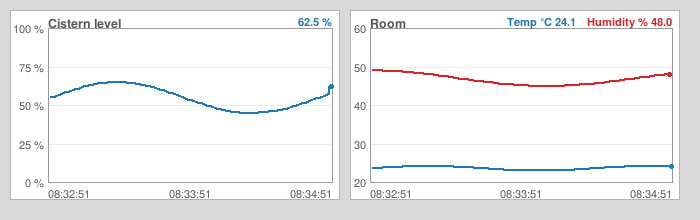

# 6. Programming

The code behind a form is an ordinary Python file. PanelWorks loads it when
the panel starts and calls its functions when events happen. This chapter covers
everything you need to write that code. You don't need to know Python well to
start; the patterns here cover most panels.

## Event procedures

An event procedure is a function named **`Object_Event`**:

```python
def cmdStart_Click(f):
    f.lblStatus.Caption = "Running"
```

- **`Object`** is the control's Name, exactly (capitals matter).
- **`Event`** is one of that control's events (chapter 12 lists them all).
- The first argument, **`f`**, is the form, like VB's `Me`. Through it you reach
  every control.
- Some events pass more arguments after `f`:

| Event | Procedure |
|---|---|
| TextBox KeyPress | `def txtName_KeyPress(f, key_ascii):` |
| Serial DataArrival | `def ser1_DataArrival(f, line):` |
| MQTT MessageArrived | `def mqtt1_MessageArrived(f, topic, payload, retained):` |
| any Error | `def ser1_Error(f, message):` |
| WebhookResponse | `def cmdAsk_WebhookResponse(f, data):` |

You may leave arguments off the end if you don't need them:
`def ser1_DataArrival(f):` is fine. The easiest way to get them right is to let
the designer write the first line for you (double-click, or pick from the
Code window's lists).

### The form's own events

```python
def Form_Load(f):
    # runs once, after every control is built, before the user can do anything
    f.txtSetpoint.Text = "85"
    f.lstLog.AddItem("Panel started")

def Form_Unload(f):
    # runs as the window closes: save settings, switch things off
    pass
```

Properties set in the designer are applied **before** any events fire, so
building the form never triggers your procedures. Events start with `Form_Load`.

## Properties: reading and setting

Everything is done with properties. Read one by naming it; set it with `=`.

```python
level = f.barLevel.Value              # read
f.barLevel.Value = level + 5          # set
f.lblLevel.Caption = f"{level} %"     # set from an expression
f.cmdStop.Enabled = False             # True/False
f.shpPump.FillColor = "lime green"    # colours by name or "#rrggbb"
f.Caption = "Pump Panel - running"    # the form's own properties: f.Caption, f.BackColor
```

Some properties fire events when set from code, as in VB: setting a TextBox's
`Text` fires its `Change`, and setting a CheckBox's `Value` fires its `Click`.
Keep that in mind if a procedure sets the property of the control whose event
it is handling.

## Methods: doing things

Methods are called with brackets:

```python
f.lstLog.AddItem("Pump on")           # add to the end
f.lstLog.AddItem("Newest", 0)         # add at the top
f.lstLog.RemoveItem(0)
f.lstLog.Clear()
f.cmdStart.Click()                    # press a button from code
f.txtName.SetFocus()
f.MsgBox("Tank is full", "Warning")   # pop-up message, waits for OK
f.Unload()                            # close the panel (VB's Unload Me / End)
```

## Text, numbers and formatting

Properties like `Caption` and `Text` are text. Convert before doing arithmetic:

```python
setpoint = int(f.txtSetpoint.Text)          # "85" -> 85     (VB: CInt / Val)
volts = float(f.txtVolts.Text)              # "12.6" -> 12.6
f.lblTotal.Caption = str(a + b)             # number -> text (VB: CStr)
f.lblTemp.Caption = f"{temp:.1f} °C"         # f-string: 1 decimal place
f.lblFlow.Caption = f"{flow:,.0f} gal"       # thousands separator
```

Check text before converting, or the conversion raises an error:

```python
t = f.txtSetpoint.Text.strip()
if t.isdigit():
    setpoint = int(t)
```

Or catch the error (VB's `On Error`):

```python
try:
    volts = float(f.txtVolts.Text)
except ValueError:
    f.lblStatus.Caption = "Enter a number"
    return
```

## Remembering things between events (form-level variables)

Variables made inside a procedure vanish when it ends. To keep a value between
events (VB's form-level `Dim`), create it at the top of the file and declare
it `global` in any procedure that **changes** it:

```python
import time

pump_on = False          # form-level: survives between events
starts = 0


def cmdStart_Click(f):
    global pump_on, starts
    pump_on = True
    starts += 1
    f.lblStarts.Caption = f"Starts today: {starts}"


def tmrPoll_Timer(f):
    if pump_on:          # reading needs no 'global'
        f.barLevel.Value -= 1
```

## Helper procedures

Write your own functions for anything you do in more than one place. They appear
under `(General)` in the Code window. Pass `f` along if they touch controls:

```python
def log(f, text):
    f.lstLog.AddItem(time.strftime("%H:%M:%S  ") + text, 0)   # newest on top
    if f.lstLog.ListCount > 50:
        f.lstLog.RemoveItem(50)


def cmdStart_Click(f):
    log(f, "Pump started")
```

## Charts

A **Chart** plots readings over time. Setting its `Value` adds a point:

```python
def ser1_DataArrival(f, line):
    f.chtVolts.Value = float(line)          # one line per reading

def tmrPoll_Timer(f):
    f.chtRoom.AddPoint(read_temp(), "Temp")  # by series name
    f.chtRoom.AddPoint(read_rh(), "RH")
```

Set **Series** (one name per line) for several lines, **Window** for how many
seconds to show, and **AutoScale** off with **YMin**/**YMax** for a fixed scale
(a tank 0–100 %). Often you need no code at all: subscribe the Chart's `Value`
to an MQTT topic, or point a Serial **Fill** line at it.



## Timers

A Timer fires its `Timer` event every `Interval` milliseconds while `Enabled`
is True. Use it for anything periodic: polling, animation, timeouts, clocks.

```python
def tmrPoll_Timer(f):
    f.lblClock.Caption = time.strftime("%H:%M:%S")

def cmdAuto_Click(f):
    f.tmrPoll.Interval = 5000
    f.tmrPoll.Enabled = True      # start
    # f.tmrPoll.Enabled = False   # stop
```

A one-shot delay: enable the timer, and disable it in its own event.

```python
def cmdPrime_Click(f):
    f.shpValve.FillColor = "orange"
    f.tmrPrime.Interval = 3000
    f.tmrPrime.Enabled = True

def tmrPrime_Timer(f):
    f.tmrPrime.Enabled = False     # only once
    f.shpValve.FillColor = "gray"
```

## Don't freeze the window

While an event procedure runs, the window can't redraw or respond, the same
as in VB. Keep procedures quick. In particular:

- **Never `time.sleep()` in an event procedure.** Use a Timer for delays.
- **Never loop waiting** for something to happen. Let its event tell you
  (DataArrival, MessageArrived, a Timer tick).
- For **slow work** (a big download, a slow calculation), run it on a
  background thread. Don't touch controls from that thread; hand the result back
  with `f.post(function, args...)`, which runs it on the window's thread:

```python
import threading, urllib.request

def show_weather(f, text):
    f.lblWeather.Caption = text            # runs on the window's thread: safe

def cmdWeather_Click(f):
    f.lblWeather.Caption = "Fetching..."
    def work():
        text = urllib.request.urlopen("https://wttr.in/?format=3", timeout=10).read().decode()
        f.post(show_weather, f, text)       # hand back to the window
    threading.Thread(target=work, daemon=True).start()
```

PanelWorks's own connections (Serial, MQTT, webhooks) already work this way.
Their events always arrive on the window's thread, so you never need
`f.post` for them.

## Reaching controls by name (VB's control arrays)

`f["name"]` reaches a control by a name built at run time. It does the job
VB's control arrays did:

```python
# four lamps called shpZone1 .. shpZone4
def set_zones(f, states):
    for i, on in enumerate(states, start=1):
        f[f"shpZone{i}"].FillColor = "lime green" if on else "gray"
```

`f.objects` is a dictionary of every control, so you can loop over them all:

```python
for name, ctl in f.objects.items():
    if ctl.Type == "TextBox":
        ctl.Text = ""
```

You can also add and remove controls while the panel runs:

```python
f.add_object("lblExtra", "Label", {"Caption": "Added at run time", "Left": 10, "Top": 200})
f.remove_object("lblExtra")
```

## Using Python's libraries

Everything in Python's standard library is available. Put `import` lines at the
top of the file. A few that suit panels:

```python
import time, datetime        # clocks, timestamps
import math, statistics      # sums, averages
import csv, json, sqlite3    # logging and storage
import os, subprocess        # files, running other programs
import urllib.request        # fetching web pages and APIs
```

Log readings to a CSV file that opens in Excel or LibreOffice:

```python
import csv, time

def ser1_DataArrival(f, line):
    with open("readings.csv", "a", newline="") as fh:
        csv.writer(fh).writerow([time.strftime("%Y-%m-%d %H:%M:%S"), line])
```

Libraries installed with pip into the PanelWorks venv work too:
`C:\dev\panelworks\.venv\Scripts\python -m pip install requests`.

## Asking the user questions

`f.MsgBox` shows a message. For yes/no questions and typed input, use
Tkinter's dialogs and pass `parent=f.root` so they appear over your panel:

```python
from tkinter import messagebox, simpledialog

def cmdReset_Click(f):
    if messagebox.askyesno("Reset", "Clear the run hours?", parent=f.root):
        f.lblHours.Caption = "0"

def cmdName_Click(f):
    name = simpledialog.askstring("Name", "Panel name:", parent=f.root)
    if name:
        f.Caption = name
```

## Logging to a database (Data and Grid)

A **Data** control (it sits in the tray) is a SQLite database file beside your
form, `<form>.db` unless you set DatabaseName. Tell it what a row holds, and
how often, in **LogFields** and **LogEvery**:

```
level = barLevel.Value
pump = shpPump.FillColor
temp = lblTemp.Caption
```

With LogEvery = 60, it logs a row a minute, with a timestamp, and no code. The
columns are created for you, and adding a line later just adds a column.
Numbers are stored as numbers. Draw a **Grid**, set its **DataSource** to the
Data control, and it shows the newest rows, updating as they're logged.


In code:

```python
def cmdCapture_Click(f):
    f.datLog.Log()                                   # log the LogFields now

def cmdTicket_Click(f):
    f.datTickets.Log({"ticket": f.txtTicket.Text,    # or your own values
                      "gross": gross, "tare": tare, "net": gross - tare})

def datLog_Logged(f, row):
    f.lblLast.Caption = f"Logged #{row['id']} at {row['time']}"

def cmdExport_Click(f):
    path = f.datLog.ExportCSV()                      # opens in Excel / LibreOffice
    f.MsgBox(f"Saved {path}")

def cmdToday_Click(f):
    rows = f.datLog.Query("SELECT AVG(level) AS avg FROM log WHERE time >= date('now','localtime')")
    f.lblAvg.Caption = f"Average today: {rows[0]['avg']:.1f} %"
```

**RecordSource** is the query a bound Grid shows (default: newest 100 rows).
Set it to anything, e.g. `SELECT time, level FROM log WHERE level < 20 ORDER BY id DESC`.
The `.db` file opens in any SQLite tool (DB Browser for SQLite is free), and
n8n's SQLite node can read it too.

A Grid can also be filled from code: set **Columns**, then `AddRow(...)`, `Clear()`,
`Rows = [[...], [...]]`; read `Row`, `Text` and `Cell(row, column)`.

## Saving settings between runs

A small JSON file next to the form is the simplest way:

```python
import json, os
SETTINGS = os.path.join(os.path.dirname(__file__), "settings.json")

def Form_Load(f):
    if os.path.exists(SETTINGS):
        s = json.load(open(SETTINGS))
        f.txtSetpoint.Text = s.get("setpoint", "85")

def Form_Unload(f):
    json.dump({"setpoint": f.txtSetpoint.Text}, open(SETTINGS, "w"))
```

## When something goes wrong

**Syntax errors** are caught when you save in the Code window (chapter 5).

**Run-time errors**, such as a misspelt control name, text that isn't a number,
or a file that isn't there, stop that one procedure. The panel carries on, and:

- the designer's status bar shows **Panel error:** and the message, when you
  started it with ▶ Start;
- the full details (the *traceback*, ending with the line number) are printed
  to the console, when you started it from a Command Prompt;
- Claude sees the error attached to the event, if it's connected (chapter 11).

Reading a traceback: the **last line** says what went wrong; the line
above it that names your `.py` file says where.

```
  File "C:\Users\you\Documents\PanelWorks\Hello.py", line 9, in cmdGreet_Click
    f.lblHelo.Caption = "Hello"
AttributeError: Form has no object or member 'lblHelo'
```

**Debugging with print**: `print(...)` is PanelWorks' `Debug.Print`. Its output
appears in the **Immediate window** (below) when you run with ▶ Start, or in the
console when you run a panel from a Command Prompt.

## The Immediate window


**View → Immediate Window**, **Ctrl+G** (as in VB), or the **Immediate** toolbar
button. While a panel runs it shows, live:

- everything your code `print()`s,
- errors, in red, with the traceback (the last red line says what went wrong,
  and the line naming your `.py` file says where),
- messages from PanelWorks itself (`[mqtt] ...`, `[serial] ...`, `[webhook] ...`), in grey.

You can also type at the running panel, VB-style, and press Enter:

| Type | Does |
|---|---|
| `? lblStatus.Caption` | Show a property (`print f.lblStatus.Caption` works too) |
| `? lblStatus` | Show every property of a control |
| `lblStatus.Caption = "Hello"` | Set a property. Values are Python literals: `42`, `3.5`, `True`, `"text"`, `["a", "b"]` |
| `lstLog.AddItem("x", 0)` | Call a method |
| `cmdStart_Click` | Fire an event, as if it happened |
| `cls` | Clear the window |
| Up / Down | Previous lines |

This is the quickest way to try things: poke a property, fire an event, and see
what your code prints, without editing anything. Typed lines go through the same
safe channel Claude uses, so they can only read and set properties, call methods
and fire events. They can't run arbitrary code inside the panel.

The window keeps collecting output while hidden, and starts a new section each
time you press Start.

## The thread rule (for the curious)

Only the window's thread may touch controls. That rule comes from Tkinter, and
VB had the same one. PanelWorks keeps it for you: Serial, MQTT and webhook
traffic and Claude's MCP calls all run in the background, and they hand every
change to the window's thread through a queue that is drained every 20 ms. Your
event procedures always run on the window's thread. The only time you need to
think about it is when you start your own threads (see *Don't freeze the
window*).
