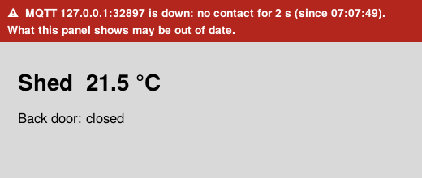
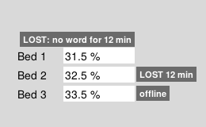

# 8. MQTT

MQTT is how most ESP32s, Tasmota and Shelly devices, Node-RED, n8n and Home
Assistant talk to each other. PanelWorks speaks it natively: a property can
follow a topic, an event can publish to one, and the whole form can mirror
itself to the broker. All of this works with no code.

## MQTT in one minute

- A **broker** (Mosquitto, usually) is the post office. Everyone connects to it.
- Messages are sent to a **topic**, a path like `home/cistern/level`.
- Clients **publish** messages to topics and **subscribe** to the topics they
  care about. `+` matches one level (`home/+/level`), `#` matches everything
  below (`home/#`).
- A **retained** message is kept by the broker and handed to anyone who
  subscribes later, so a panel shows the last known level as soon as it opens.
- The **payload** is text, often JSON: `{"level": 62.5, "temp": 14.2}`.

For a broker on your PC, install **Mosquitto** from mosquitto.org (on Linux:
`sudo apt install mosquitto mosquitto-clients`). Its command-line tools
`mosquitto_pub` and `mosquitto_sub` are handy for testing.

There are two ways to use MQTT in a panel; use either or both.

## Way 1: no code, in the form

### Connect the form

Select the **Form** in the designer, open the **Connections** tab, and enter:

```json
{
  "mqtt": {"broker": "localhost", "port": 1883, "prefix": "panelworks/cistern"}
}
```

Click **Apply**. The panel connects when it starts, reconnects on its own, and
subscribes again after reconnecting.

| Key | Default | Notes |
|---|---|---|
| `broker` | `localhost` | Host name or IP. `${VAR}` / `${VAR:-default}` allowed in every value. |
| `port` | 1883 (8883 with `tls`) | |
| `username`, `password` | | Use `"password": "${PW_MQTT_PASS}"` to keep it out of the file. |
| `tls` | `false` | Encrypted connection, checked against the system's trusted certificates (fine for Let's Encrypt). |
| `caFile` | | A CA certificate file, for a private or self-signed broker. |
| `tlsInsecure` | `false` | Skip the certificate name check. Test brokers only. |
| `clientId` | random | |
| `prefix` | `panelworks/<form name>` | Where status and mirror topics go. |
| `status` | `true` | Publish `<prefix>/status` = `online`/`offline` (retained, with a Last Will, so it shows `offline` if the PC dies). Set `false` for read-only broker accounts. |
| `mirror` | `false` | Publish every property (see *Mirror*). |
| `mirrorInterval` | 250 | How often (ms) to check for changed properties to mirror. |

If the broker can't be reached or refuses the login, the reason is reported
once (not every retry), and `Form_MqttError(f, message)` fires so you can
show it.

### subscribe: a property follows a topic

Select a control, open **Connections**, and give it a `subscribe` entry.
The simplest form is just the topic:

```json
{"subscribe": {"Caption": "home/cistern/level"}}
```

Every message on that topic now sets the label's Caption. The full form takes
options, applied in this order:

```json
{"subscribe": {
   "Value": {"topic": "home/cistern/telemetry", "json": "level", "scale": 1}
}}
```

| Option | Does | Example |
|---|---|---|
| `topic` | The topic, or a filter with `+`/`#`. | `"home/cistern/level"` |
| `json` | Pick a field out of a JSON payload. Dots for nested fields, numbers for list items. | `"level"`, `"sensors.0.temp"` |
| `map` | Translate values. `*` matches anything else. | `{"ON": "lime green", "OFF": "gray", "*": "orange"}` |
| `scale` | Multiply a number. | `0.1` turns 625 into 62.5 |
| `format` | Python format for the result. | `"{:.1f} °C"`, `"node {}"` |
| `twoWay` | Also publish when the **user** changes it (TextBox Text, CheckBox Value, OptionButton Value, ComboBox Text/ListIndex, ListBox ListIndex). | `true` |
| `publishTopic` | Publish two-way changes here instead (e.g. a `/set` topic). | `"home/cistern/setpoint/set"` |
| `retain` | Retain two-way publishes. | default `true` |

Each property follows one topic; any number of controls (and properties)
can follow the same topic. A **Chart**'s `Value` (and `Value2`..`Value4`) plots
every message, even a repeated reading, so a trend line needs nothing more
than a `subscribe`. If a JSON field is missing from a message (a
device sending partial data while it boots), that message is skipped and the
control keeps its last value.

**Examples:**

```json
"shpPump":  {"type": "Shape",
             "subscribe": {"FillColor": {"topic": "home/pump/state",
                                         "map": {"ON": "lime green", "OFF": "gray", "*": "orange"}}}}

"barLevel": {"type": "ProgressBar",
             "subscribe": {"Value": {"topic": "home/cistern/telemetry", "json": "level"}}}

"lblTemp":  {"type": "Label",
             "subscribe": {"Caption": {"topic": "home/cistern/telemetry", "json": "temp",
                                       "format": "{:.1f} °C"}}}

"chtLevel": {"type": "Chart", "Title": "Cistern level", "Units": "%", "Window": 3600,
             "subscribe": {"Value": {"topic": "home/cistern/telemetry", "json": "level"}}}

"txtSetpoint": {"type": "TextBox",
                "subscribe": {"Text": {"topic": "home/cistern/setpoint", "twoWay": true}}}
```

### publish: an event sends a message

```json
{"publish": {"Click": {"topic": "home/pump/cmd", "payload": "ON"}}}
```

| Option | Does |
|---|---|
| `topic` | Where to send. |
| `payload` | What to send. `{Property}` inserts a property of this control: `"{Text}"`, `"{Value}"`. Without a payload, it sends the control's Value if it has one, otherwise the event name. A Serial control sends the line. |
| `retain`, `qos` | Optional. |

One event can publish several messages: give a list.

```json
{"publish": {"Click": [
   {"topic": "home/pump/cmd", "payload": "ON"},
   {"topic": "panelworks/log", "payload": "pump started from the panel"}
]}}
```

No echo loops: a value that arrives from a topic is never published back to the
same topic, and a message that doesn't change the value is ignored.

### Mirror: the whole form on the broker

Set `"mirror": true` in the form's `mqtt` block, and:

- every property of every control is published, retained, to
  `<prefix>/<control>/<property>` whenever it changes;
- every event (except Timer ticks) is published to `<prefix>/<control>/event`;
- publishing to `<prefix>/<control>/<property>/set` sets that property.

```
mosquitto_sub -t "panelworks/cistern/#" -v
mosquitto_pub -t panelworks/cistern/lblStatus/Caption/set -m "Hello from the broker"
```

Node-RED, n8n, Home Assistant and other ESP32s then see and drive the same
object model you program against.

## Way 2: the MQTT control, in code

For full control, draw an **MQTT** control (it goes in the tray) and handle
its events, as you'd have used the Winsock control in VB.

Set **Broker** (and Port, Username, Password, TLS as needed) and list topics
in **Subscriptions**, one per line. Then:

```python
def mqtt1_MessageArrived(f, topic, payload, retained):
    if topic == "home/cistern/level":
        f.barLevel.Value = float(payload)
    elif topic.startswith("home/alarm/"):
        f.lstAlarms.AddItem(f"{topic.split('/')[-1]}: {payload}", 0)

def cmdFlush_Click(f):
    f.mqtt1.Publish("home/valve/flush", "OPEN")

def mqtt1_Connected(f):
    f.shpLink.FillColor = "lime green"

def mqtt1_Disconnected(f):
    f.shpLink.FillColor = "red"
```

JSON payloads are decoded with Python's `json` module:

```python
import json

def mqtt1_MessageArrived(f, topic, payload, retained):
    data = json.loads(payload)
    f.lblTemp.Caption = f"{data['temp']:.1f} °C"
```

The control connects when the form loads (`AutoConnect`), reconnects by
itself, and re-subscribes after reconnecting. `Subscribe(topic)` and
`Unsubscribe(topic)` change subscriptions at run time.

## When the broker is down: the link banner

A panel that has lost its broker still shows the last values it got, and they
look exactly like fresh ones. So when a link has been down for 5 seconds, a red
bar goes across the top of the running panel:



It names the link, says how long it has been gone and since when, and stays
until the link is back. Several links down are listed together. Two connections to the
same place (the form's `mqtt` settings and an MQTT control on the same broker) are listed
once; LinkDown below still fires for each, since each is its own connection. The phone view
(chapter 16) shows the same warning. It covers every control that talks to
something: the form's own `mqtt` settings, MQTT, Modbus, SNMP, Serial, InfluxDB
and WebRequest. A link you close on purpose (`Disconnect`, `Close`) isn't
watched until you open it again. The 5 seconds cover connecting at start-up and
short blips.

Code can react too:

```python
def Form_LinkDown(f, name, label):          # name: the control, or "Form" for the form's mqtt
    f.lblStatus.Caption = f"No contact: {label}"
    f.shpLamp.FillColor = "grey"

def Form_LinkUp(f, name, label, seconds_down):
    f.lblStatus.Caption = f"{label} back after {seconds_down} s"
```

`f.LinksDown` lists what's down right now (empty when all is well).
To leave one control out (an internet weather API you don't mind losing, say),
set its **WatchLink** to False. To hide the bar but keep the events, set the
form's **LinkBanner** to False in the designer (it's saved as
`"linkBanner": false`).

## When a device goes quiet: the Watchdog

The link banner covers the panel's own connection. A device can die while the broker is
fine: an ESP32 out of Wi-Fi range, a probe with a flat battery. Its last values stay on the
panel looking perfectly normal. The **Watchdog** control (invisible, in the tray) knows how
often each device should report and says when one goes quiet:



Give it one line per device in **Devices**:

```
garden  = home/garden/telemetry every 300
probe5  = home/garden/probe5/# every auto lwt home/garden/probe5/status
cistern = home/cistern/telemetry every 60 show lblCistern,gauLevel
```

| Part | Meaning |
|---|---|
| `name = topic ...` | The topics that count as hearing from it (`+` and `#` work). |
| `every 300` | It should report every 300 seconds. |
| `every auto` | It says so itself, in a JSON `"every"` (or `"interval"`) field, in seconds. Until it does, **DefaultInterval** (60). |
| `lwt TOPIC [word]` | Its Last Will topic: `offline` (or your word) there means LOST, about 2 s later (see below). |
| `show ctl,ctl` | Controls to mark when it's quiet. Controls **bound** to its topics in the form's `mqtt` settings are found by themselves. |

Each device is **WAITING** (not heard since the panel started), **OK**, **LATE** (quiet for
**LateAfter** intervals, 2 by default) or **LOST** (**LostAfter**, 3, or its Last Will said
so). The controls it feeds get a grey "no word for 12 min" tag ("offline (Last Will)" when
the Will said so), and the phone view lists it. The tag goes beside the control, or above it,
where it covers nothing; on a crowded panel it shrinks to a badge such as "LOST 12 min".
Its events:

```python
def wd1_DeviceLate(f, name, seconds): ...
def wd1_DeviceLost(f, name, seconds, why):   # why: "timeout" or "lwt"
    f.lblStatus.Caption = f"{name}: no word for {seconds // 60} min"
def wd1_DeviceBack(f, name, seconds): ...
```

`wd1.Values` is `{"garden": "OK", ...}`, so an alarm rule (chapter 18) can name a device:
`GardenLost: wd1.garden == LOST priority=1`. `wd1.Quiet` lists the devices that aren't OK,
`wd1.State("garden")` and `wd1.Age("garden")` ask about one, and `wd1.Heard("pump")`
lets your code say it heard a device some other way (over Serial or Modbus, say).

Two rules keep it honest:

- **A retained message isn't news.** When the panel starts, the broker hands over the last
  retained value of each topic, which may be from yesterday. That fills a bound label, but
  the device stays WAITING until it actually says something. (The Last Will topic is the
  exception: a retained `offline` there is current, and so is `online`.)
- **While the panel's own link to the broker is down, the clocks stop.** Nobody can be heard
  then, so nothing goes LATE or LOST because of it (the link banner says what's wrong).
  When the link is back, a device that was OK gets an interval to report.
- **A broker that is shutting down sends every client's Last Will first,** just before the
  panel's own link drops. So a live `offline` waits 2 seconds, and if the panel's link goes
  down in that time it was the broker stopping, not the device: it's dropped. In the same
  way, a retained `offline` that a restarted broker replays at reconnect gets one interval
  for the device to come back before it counts.

**Source** picks the connection it listens on: empty means the form's own `mqtt` settings
(or the first MQTT control if there are none), or name an MQTT control. It doesn't open a
connection of its own.

The Watchdog is the console's view. If a quiet device should raise the house alarm, decide
that on the server (Node-RED, n8n), so it works with no panel open.

## The device side

An ESP32 publishing JSON that the panel above understands (Arduino, PubSubClient library):

```cpp
char msg[64];
snprintf(msg, sizeof msg, "{\"level\":%.1f,\"temp\":%.1f}", level, tempC);
client.publish("home/cistern/telemetry", msg, true);     // retained
```

## A safe pattern for real equipment

If a panel only needs to **watch** equipment that is controlled elsewhere
(a thermostat drives the HVAC relays, for instance), give it a broker account
that can only read those topics, and set `"status": false`:

```
# Mosquitto ACL
user panelworks
topic read home/#
topic readwrite panelworks/#
```

Then no bug in the panel and no mistake by Claude can switch anything. See the
HVAC console example in chapter 13.

## Trying it without hardware

```
mosquitto                                   # a broker on localhost:1883
python tests/fake_esp32.py                  # a simulated cistern node
python -m panelworks --example cistern_mqtt
mosquitto_sub -t "panelworks/cistern/#" -v  # watch the panel mirror itself
```
