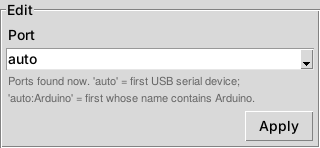

# 9. Serial: Arduinos, GPS units, radios

The **Serial** control talks to anything on a serial port: an Arduino or ESP32
on USB, a GPS, a radio's CAT port, a TNC, a scale, a multimeter. It does VB's
MSComm job, without MSComm's headaches.

Use Serial for devices **plugged into the PC**, and MQTT (chapter 8) for
devices on the network. A Serial control can also bridge one to the other.

## Quick start

1. Draw a **Serial** control. It goes in the tray, named `Serial1`; rename it
   `ser1` or similar.
2. **Port**: pick your device from the drop-down, which lists the ports present
   with their names (`COM3 - USB-SERIAL CH340`), or leave it as `auto`.
3. **Settings**: the speed your sketch uses in `Serial.begin(...)`, for example
   `115200,n,8,1`.
4. Double-click it and handle the lines it receives:

```python
def ser1_DataArrival(f, line):
    f.lblLast.Caption = line
```

5. Send to the device by setting **Output**:

```python
def cmdOn_Click(f):
    f.ser1.Output = "LED ON"        # sends "LED ON" plus the line ending
```

That's the whole cycle. The port opens when the panel starts and closes when it ends.



## Lines, not chunks

A serial port delivers bytes whenever they happen to arrive. MSComm passed
you whatever had arrived (`OnComm` with half a line), and every VB program
needed the same buffer-and-split code. The Serial control does it for you:
**DataArrival fires once per complete line**, without the line ending.

| Terminator | Splits on | Use for |
|---|---|---|
| `LF` (default) | newline; a CR before it is removed too | Arduino `Serial.println`, most devices |
| `CR` | carriage return | Many radios and old instruments |
| `CRLF` | CR+LF only | Strict CRLF devices |
| `None` | nothing: every chunk fires as it arrives | Binary or unframed data |

When sending, **Output** and **SendLine** add the terminator (a newline
for `None`); **Write** sends exactly what you give it.

## Finding the port: no more COM-number guessing

| Port value | Opens |
|---|---|
| `COM3`, `/dev/ttyUSB0` | That port. |
| `auto` | The first USB serial device found. |
| `auto:Arduino` | The first port whose name contains "Arduino". Also `auto:CH340`, `auto:CP210`, `auto:FTDI`, `auto:Silicon Labs`, any text from the drop-down. |
| `socket://192.168.1.50:23` | A network serial server (ser2net, ESP-Link, a terminal server). |
| `rfc2217://host:port` | An RFC 2217 serial server (adjustable baud). |
| `loop://` | A loopback for testing: everything sent comes straight back. |

`auto:...` matters because Windows often gives a board a **different COM number**
after it's plugged into another USB socket. A panel set to `auto:CH340` finds
it anyway. `DeviceName` tells you which port it actually opened.

## Unplug and replug

With **AutoReconnect** on (the default), unplugging the board fires
`Disconnected`; plugging it back in reopens the port and fires `Connected`.
If the device isn't there when the panel starts, it keeps looking every two
seconds. You can show the state with a lamp:

```python
def ser1_Connected(f):
    f.shpLink.FillColor = "lime green"
    f.lblLink.Caption = f"Connected on {f.ser1.DeviceName}"

def ser1_Disconnected(f):
    f.shpLink.FillColor = "red"
    f.lblLink.Caption = "Unplugged - waiting..."

def ser1_Error(f, message):
    f.lblLink.Caption = message
```

Problems are reported **once** through `Error` (and kept in `LastError`),
not on every retry.

## Readings with no code: Fill

If your device sends JSON lines, **Fill** copies fields straight into
properties. Enter one mapping per line:

```
temp -> lblTemp.Caption
light -> pbLight.Value
env.hum -> lblHum.Caption
```

Device sends: `{"temp": 21.5, "light": 612, "env": {"hum": 40}}`, and all three
controls update, with no code at all. Plain `key=value` lines work too:
`temp=21.5, light=612` or `temp:21.5`. A missing field leaves its control
unchanged, and DataArrival still fires for every line.

## Arduino sketch to match

```cpp
void setup() {
  Serial.begin(115200);
  pinMode(LED_BUILTIN, OUTPUT);
}

void loop() {
  static unsigned long last = 0;
  if (millis() - last >= 1000) {                 // one reading a second
    last = millis();
    Serial.print("{\"temp\":");  Serial.print(readTemp(), 1);
    Serial.print(",\"light\":"); Serial.print(analogRead(A1));
    Serial.println("}");                         // println ends the line
  }
  if (Serial.available()) {                      // commands from the panel
    String cmd = Serial.readStringUntil('\n');
    cmd.trim();
    if (cmd == "LED ON")  digitalWrite(LED_BUILTIN, HIGH);
    if (cmd == "LED OFF") digitalWrite(LED_BUILTIN, LOW);
  }
}
```

The complete example is `examples/arduino_bench/arduino_bench.ino` with the panel
`examples/arduino_bench.json` (chapter 13).

## Settings

`Settings` is `baud,parity,databits,stopbits`, as in MSComm:

| Part | Values |
|---|---|
| baud | 300 … 921600 (match the device) |
| parity | `n` none, `e` even, `o` odd, `m` mark, `s` space |
| data bits | 5, 6, 7, 8 |
| stop bits | 1, 1.5, 2 |

Common: `9600,n,8,1`, `115200,n,8,1`; `4800,n,8,1` for NMEA GPS; `1200,n,8,1`
for old TNCs. Settings can be changed while the port is open; the new speed
applies at once. A mistake (`fast,n,8,1`) is refused with a message saying what's wrong.

## The Arduino reset (DTR)

Most Arduinos (Uno, Nano, Mega) **reset when a program opens the port**,
because the DTR line pulses. That's why the first second of data is missing and
setup() runs again. If that's a problem, set **DTR** to False before the port
opens (in the designer). ESP32 boards use DTR and RTS for their boot button,
and normally behave with the defaults.

## Text encodings

Lines are decoded as UTF-8 by default; anything invalid is replaced with `�`
rather than causing an error. For devices that send raw 8-bit data, set
**Encoding** to `latin-1`.

## Input and InBufferCount: the MSComm way

If you prefer to read the buffer yourself, as in MSComm: `InBufferCount`
says how many characters are waiting, and reading `Input` returns them all
and empties the buffer. `ClearInput()` empties it without reading. (Lines
still fire DataArrival either way.)

## Bridging serial to MQTT and n8n

The usual connections work on Serial events, so a USB device can be put on the
network with a few lines of JSON on the control's **Connections** tab:

```json
{
  "publish":   {"DataArrival": {"topic": "bench/arduino/line"}},
  "subscribe": {"Output": "bench/arduino/cmd"}
}
```

Every line from the board is published to `bench/arduino/line` (the default
payload is the line). Anything published to `bench/arduino/cmd` is sent to
the board. With a `webhook` entry, lines can go to n8n instead (chapter 10).

## Common problems

| Symptom | Cause and cure |
|---|---|
| `Access is denied` / `could not open port` | Another program has the port open: usually the Arduino IDE's Serial Monitor or Plotter. Close it. Only one program can open a serial port at a time. |
| `no serial device matches 'auto'` | Nothing USB-serial is plugged in, or its driver isn't installed (CH340 boards often need the WCH driver on Windows). Check Device Manager → Ports. |
| Garbage characters | Settings speed doesn't match `Serial.begin(...)`. |
| No DataArrival, but InBufferCount grows | The device doesn't end lines the way Terminator expects. Try `CR`, or `None`. |
| First reading missing after opening | The Arduino reset (DTR, above). |
| Linux: `Permission denied` | Add yourself to `dialout` (chapter 2) and log in again. |
