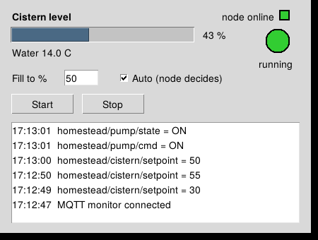
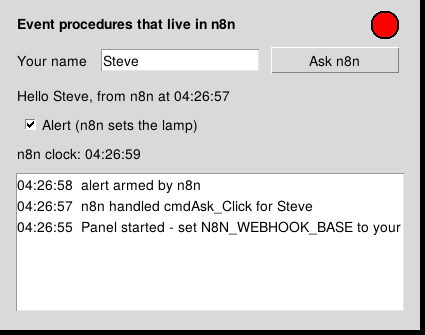

# 13. Example panels

The `examples` folder has complete panels to run, read, and copy from. Open
any of them in the designer (`panelworks-designer examples\pumppanel.json`) to
see how it's built, or run it directly.

## Pump panel: plain code, no connections


`examples/pumppanel.json` + `pumppanel.py`

A cistern pump panel with a simulated tank, the best example of ordinary VB-style
programming. It shows:

- a **Timer** (`tmrSim`) running a simulation every half second;
- form-level variables (`pump_on`) and `global`;
- helper procedures (`log`, `set_pump`, `setpoint`) used from several events;
- **TextBox validation**: the setpoint turns red while it isn't a number from 10 to 100;
- **OptionButtons** (solar/generator) and a **CheckBox** (auto mode);
- a **ListBox** log with the newest entry on top, trimmed to 50 lines.

```
panelworks examples\pumppanel.json --mcp none
```

With Claude connected (chapter 11), this is the panel to try "press Start" and
"what's the level?" on.

## Cistern (MQTT): no code at all



`examples/cistern_mqtt.json`

Every value on screen comes from a `subscribe` entry: the level bar and label
pick `level` out of a JSON payload, the pump lamp maps `ON`/`OFF` to colours,
and the node lamp shows online/offline. The buttons `publish` commands. Mirror
is on, so the whole panel also appears on the broker.

```
mosquitto
python tests\fake_esp32.py
panelworks examples\cistern_mqtt.json
```

`tests/fake_esp32.py` pretends to be the cistern node, so no hardware is needed.

## HVAC console: real devices over TLS, read-only


`examples/hvac_console.json` + `hvac_console.py`

Watches two ESP32s, a thermostat display and a relay board, through an internet
broker with TLS. It shows:

- `"tls": true` with the broker's Let's Encrypt certificate;
- connection details from **environment variables** (`PW_MQTT_HOST`,
  `PW_MQTT_USER`, `PW_MQTT_PASS`), so the file holds no secrets;
- `map` and `format` turning raw telemetry into lamps and readable text;
- the **read-only pattern**: `"status": false` and a broker account that can
  only read `home/#`, so the console can never switch the HVAC.

```
set PW_MQTT_HOST=mqtt.example.com
set PW_MQTT_USER=panelworks
set PW_MQTT_PASS=...
panelworks examples\hvac_console.json --mcp none
```

## n8n demo: event procedures in a workflow



`examples/n8n_demo.json` + `n8n_demo.py`, workflow `examples/n8n/panelworks-demo.workflow.json`

The Ask button's Click is handled by n8n: the panel sends the typed name, and
the workflow replies with a greeting, a lamp colour and a log line. A poll every
10 seconds shows n8n's clock. The Alert check box turns the lamp red through
n8n. Import the workflow (chapter 10), publish it, set `N8N_WEBHOOK_BASE`, and run.

## Arduino bench: USB serial


`examples/arduino_bench.json` + `arduino_bench.py`, sketch
`examples/arduino_bench/arduino_bench.ino`

An Arduino sends `{"temp":..,"light":..}` once a second; **Fill** puts the values
into a label and a progress bar with no code. The LED buttons send commands.
The link lamp turns red if you unplug the board and green when it's back.

1. Open the sketch in the Arduino IDE, upload it, then **close the Serial Monitor**.
2. `panelworks examples\arduino_bench.json --mcp none`

With nothing wired to A0 and A1 the readings float randomly, which is enough
to see it working. A TMP36 on A0 and a light-dependent resistor divider on A1
make it real.

## Copying an example

Copy both files (`.json` and `.py`) to your own folder and open the copy in the
designer. If you rename the `.py`, change the form's **Code** property to
match.
