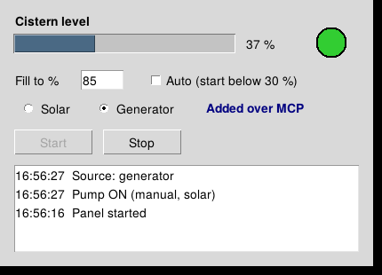
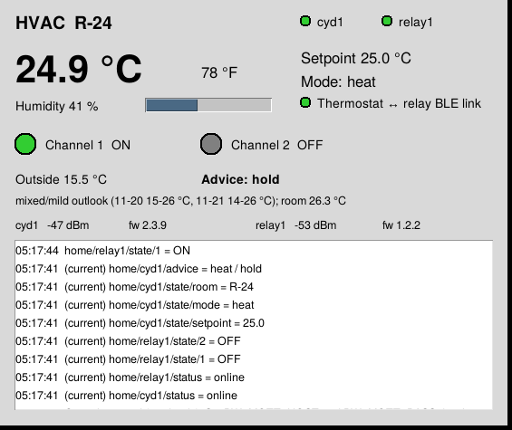
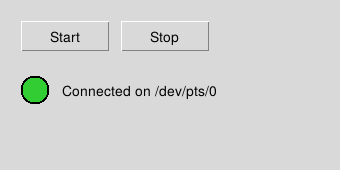
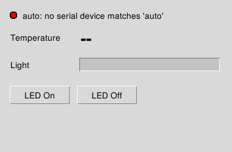
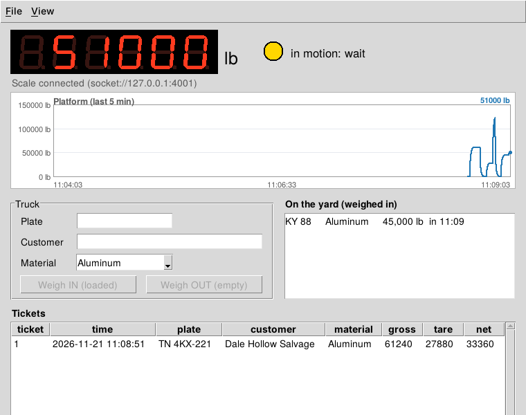
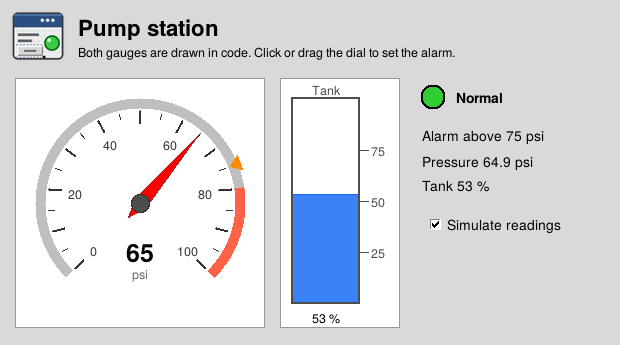
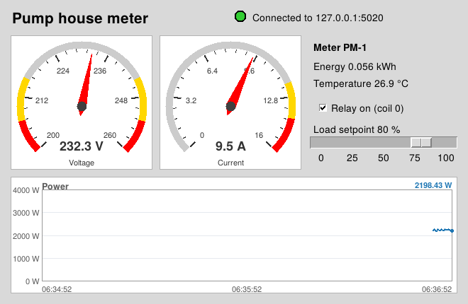
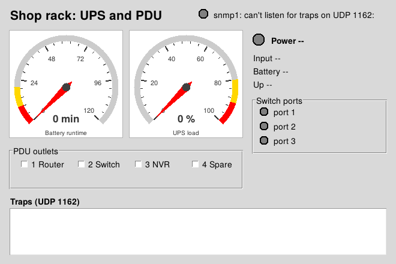
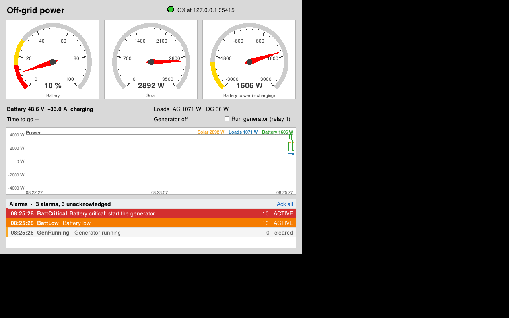

# 13. Example panels

The `examples` folder has complete panels to run, read, and copy from. The
easiest way in is the designer's **File → Examples** menu: it opens a copy in
your panels folder (with its code and any Arduino sketch), so you can change it
freely and the original stays clean for `git pull`. Or run one directly from
the command line, as shown under each example. The commands work from any folder,
whether you cloned PanelWorks or installed it from PyPI:

```
python -m panelworks --example                         (list the examples)
python -m panelworks --example power_meter --mcp none  (run one)
python -m panelworks --simulator power_meter           (its pretend device, in a second window)
```

With a PyPI install, `--example` copies the example to your panels folder the first
time and runs that copy, like File → Examples. Use `python` from your PanelWorks
environment (`.venv\Scripts\python` or `pw\Scripts\python`) if `python` alone
finds a different one.

## Pump panel: plain code, no connections



`examples/pumppanel.json` + `pumppanel.py`

A cistern pump panel with a simulated tank, the best example of ordinary VB-style
programming. It shows:

- a **Timer** (`tmrSim`) running a simulation every half second;
- form-level variables (`pump_on`) and `global`;
- helper procedures (`log`, `set_pump`, `setpoint`) used from several events;
- **TextBox validation**: the setpoint turns red while it isn't a number from 10 to 100;
- **OptionButtons** (solar/generator) and a **CheckBox** (auto mode);
- a **ListBox** log with the newest entry on top, trimmed to 50 lines.

```
python -m panelworks --example pumppanel --mcp none
```

With Claude connected (chapter 11), this is the panel to try "press Start" and
"what's the level?" on.

## Cistern (MQTT): no code at all


`examples/cistern_mqtt.json`

Every value on screen comes from a `subscribe` entry: the level bar and label
pick `level` out of a JSON payload, the pump lamp maps `ON`/`OFF` to colours,
and the node lamp shows online/offline. The buttons `publish` commands. Mirror
is on, so the whole panel also appears on the broker.

```
mosquitto
python tests\fake_esp32.py
python -m panelworks --example cistern_mqtt
```

`tests/fake_esp32.py` pretends to be the cistern node, so no hardware is needed.

## HVAC console: real devices over TLS, read-only



`examples/hvac_console.json` + `hvac_console.py`

Watches two ESP32s, a thermostat display and a relay board, through an internet
broker with TLS, with an hour-long **Chart** of room and outside temperature. It shows:

- `"tls": true` with the broker's Let's Encrypt certificate;
- connection details from **environment variables** (`PW_MQTT_HOST`,
  `PW_MQTT_USER`, `PW_MQTT_PASS`), so the file holds no secrets;
- `map` and `format` turning raw telemetry into lamps and readable text;
- the **read-only pattern**: `"status": false` and a broker account that can
  only read `home/#`, so the console can never switch the HVAC.

Store the connection details once, so every program (the designer, shortcuts, Claude)
sees them. Run each line in a Command Prompt, then close and reopen the designer:

```
setx PW_MQTT_HOST mqtt.example.com
setx PW_MQTT_USER panelworks
setx PW_MQTT_PASS "..."
```

(`set` or PowerShell's `$env:` only last for the one window you type them in.)

## n8n demo: event procedures in a workflow


`examples/n8n_demo.json` + `n8n_demo.py`, workflow `examples/n8n/panelworks-demo.workflow.json`

The Ask button's Click is handled by n8n: the panel sends the typed name, and
the workflow replies with a greeting, a lamp colour and a log line. A poll every
10 seconds shows n8n's clock. The Alert check box turns the lamp red through
n8n. Import the workflow (chapter 10), publish it, set `N8N_WEBHOOK_BASE`, and run.

## LED panel: switch an Arduino's LED



`examples/led_panel.json` + `led_panel.py`, sketch `examples/led_panel/led_panel.ino`

Start and Stop buttons send `ON`/`OFF` over USB serial; the board switches its LED
and replies, and the lamp follows the reply. The simplest serial panel, built
step by step in chapter 9's tutorial.

```
python -m panelworks --example led_panel --mcp none
```

## Arduino bench: USB serial



`examples/arduino_bench.json` + `arduino_bench.py`, sketch
`examples/arduino_bench/arduino_bench.ino`

An Arduino sends `{"temp":..,"light":..}` once a second; **Fill** puts the values
into a label and a progress bar with no code. The LED buttons send commands.
The link lamp turns red if you unplug the board and green when it's back.

1. Open the sketch in the Arduino IDE, upload it, then **close the Serial Monitor**.
2. `panelworks --example arduino_bench --mcp none`

With nothing wired to A0 and A1 the readings float randomly, which is enough
to see it working. A TMP36 on A0 and a light-dependent resistor divider on A1
make it real.

## Truck scale: a recycling yard's weighbridge



`examples/truck_scale.json` + `truck_scale.py`, simulator `examples/truck_scale/scale_sim.py`

The most complete example (also shown on a phone in chapter 16). A scale indicator's continuous output arrives over
**Serial**; the panel shows the weight on an LED **SegmentDisplay** (`-OL-` on
overload), a lamp for stable / in motion /
overload, and a **Chart** of the platform. A loaded truck **weighs in** (gross);
after unloading it **weighs out** (tare); the ticket (plate, customer, material,
gross, tare, net) goes into a **Data** table and shows in a **Grid**. Weighing is
only allowed when the reading is stable. Trucks on the yard are kept in their
own table, so nothing is lost if the PC restarts mid-shift. There's a **Frame**
for the truck details, and a **menu**: File → Export tickets to CSV, View → Weight chart,
View → Error log. Problems (scale disconnected, database errors) go into an
**error log** in a second window, and only a red *⚠ 1 new problem* indicator shows
on the panel. Click it, or press Ctrl+L, to read them.

Without a scale, run the simulator first. It pretends to be an indicator,
trucks arriving by themselves, and you can type a weight to put one on:

```
python -m panelworks --simulator truck_scale
python -m panelworks --example truck_scale --mcp none
```

**With a real indicator:** set `ser1`'s **Port** to its COM port and **Settings** to
its baud rate (often `9600,n,8,1`), and check the line format. The code expects
the common `ST,GS,+0012340lb` style (A&D, Avery and many others: ST = stable,
US = in motion, OL = overload). For another format, change the `LINE` pattern at
the top of `truck_scale.py`; the Immediate window (Ctrl+G) with
`print(line)` in `ser1_DataArrival` shows exactly what your indicator sends.

## Gauges: drawing with the PictureBox



`examples/gauges.json` + `gauges.py`, logo in `examples/gauges/`

A pressure dial and a tank, both drawn in code on **PictureBox** controls. The dial's
box is scaled -125..125 with y pointing up, so its centre is (0, 0) and plain sin/cos
place the ticks, numbers and needle. Click the dial, or drag round it, to move the
orange alarm marker: `picGauge_Click(f, x, y)` and `picGauge_MouseMove(f, x, y)` get
the position in those same units. The tank is scaled 0..100 % up its height. The logo
at the top left is a PictureBox showing a PNG. A Timer simulates the readings, and the
whole panel works in the phone view, taps on the dial included.

```
python -m panelworks --example gauges --mcp none
```

## Power meter: Modbus TCP



`examples/power_meter.json` + `power_meter.py`, simulator `examples/power_meter/meter_sim.py`

An energy meter over Modbus TCP. The Poll list reads volts and amps (scaled), power
as a word-swapped float, energy as a 32-bit counter, the meter's name as text, a
temperature from an input register and a relay coil. Fill puts volts and amps on two
**Gauges** and power on a **Chart**, with no code. The **Slider** writes the load
setpoint register, and the CheckBox switches the relay coil. Chapter 17 explains it all.

```
python -m panelworks --simulator power_meter
python -m panelworks --example power_meter --mcp none
```

## Rack status: SNMP



`examples/rack_status.json` + `rack_status.py`, pretend devices in `examples/rack_status/`

A UPS, a PDU and a switch over SNMP. Gauges show battery runtime and load; lamps show
mains or battery and three switch ports, named from the switch itself with a Walk; four
CheckBoxes switch PDU outlets with Set; a list logs traps. Needs `pip install snmpsim pysmi`
for the pretend devices:

```
python -m panelworks --simulator rack_status
python -m panelworks --example rack_status --mcp none
python -m panelworks --simulator rack_status --trap
```

## Solar and battery: a Victron GX over Modbus, with alarms



`examples/solar_battery.json` + `solar_battery.py`, simulator `examples/solar_battery/gx_sim.py`

An off-grid system read from a Victron GX device (Cerbo GX, Venus GX) over Modbus TCP.
It reads the GX's own system registers on Unit-ID 100: battery voltage, current, power,
state of charge and time to go, solar power, AC and DC loads and generator power. So it
works whatever chargers, inverters and battery monitor are behind the GX. Fill drives
three **Gauges** and a three-line **Chart**. The CheckBox starts the generator through
the GX's relay 1 (register 806). An **Alarms** control watches for a low or critical
battery, low voltage, heavy load, a running generator and the GX going quiet. The
**AlarmPanel** lists them (chapter 18).

The pretend GX runs a whole day in 10 minutes: the sun comes up, the battery fills, and
overnight loads pull it down until the low-battery alarm asks for the generator.

```
python -m panelworks --simulator solar_battery
python -m panelworks --example solar_battery --mcp none
```

For a real system, turn on **Settings → Services → Modbus TCP** on the GX, then set the
environment variables `GX_HOST` to its address and `GX_PORT` to `502` before starting the
panel.

## Copying an example

Copy both files (`.json` and `.py`) to your own folder and open the copy in the
designer. If you rename the `.py`, change the form's **Code** property to
match.
