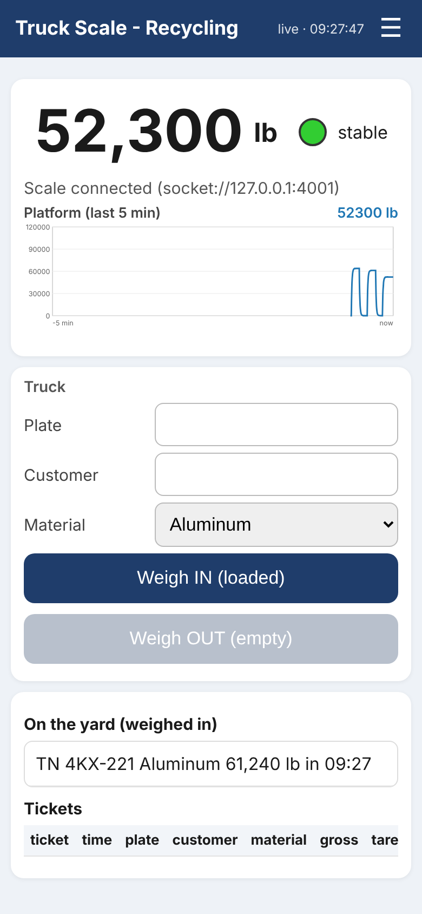
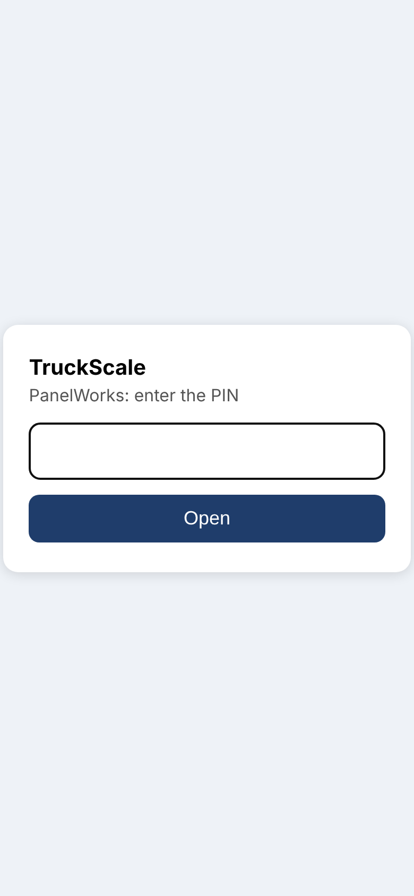
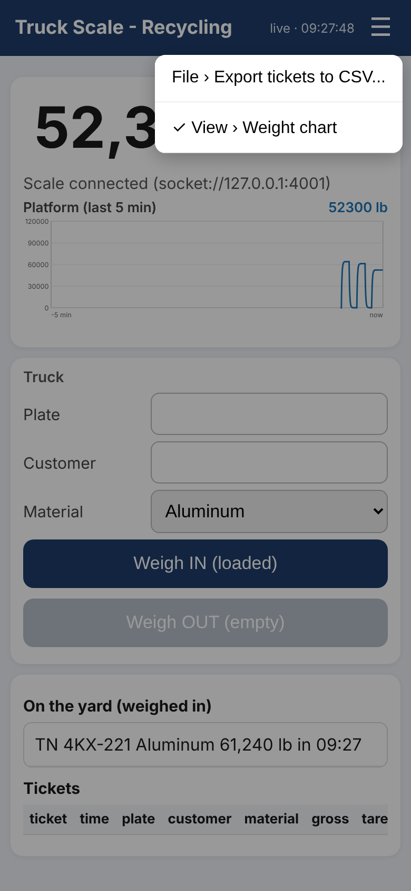

# 16. Phone view

Any running panel can also be used from a phone: checking the cistern from the
garden, starting the pump from the barn. You don't design anything twice. The
phone view is made from the same form, laid out for a small screen automatically.



## Turning it on

**In the designer:** **Tools → Phone View...**, tick *Serve this panel to phones
on my network*, then **OK**. Or add it to the form's Connections tab yourself:

```json
"web": {"port": 8080, "pin": "${PANELWORKS_PIN}"}
```

**Set the PIN once** in a Command Prompt (then restart the designer, as with any
`setx`):

```
setx PANELWORKS_PIN 4321
```

If no PIN is set, a random six-digit PIN is made each time the panel starts.

**Start the panel** (▶ Start). The Immediate window (Ctrl+G) shows where to
point the phone:

```
[web] phone view: http://192.168.1.42:8080/   PIN 4321
```

From a Command Prompt, `--web` does the same for any form, without changing the file:

```
python -m panelworks MyPanel.json --web --pin 4321
python -m panelworks MyPanel.json --web 8081 --readonly
```

## On the phone

1. Connect the phone to the same Wi-Fi as the PC.
2. Open the address in the phone's browser and enter the PIN. You stay
   logged in on that phone for 30 days.
3. To get an icon: in Safari or Chrome, choose **Share → Add to Home Screen**.
   It then opens full-screen like an app.

 

## How the layout is made

The phone shows the same controls, rearranged into one column in reading order
(top to bottom, left to right):

| On the PC | On the phone |
|---|---|
| Controls side by side at the same height | One row (they wrap if they don't fit) |
| A Label just left of a TextBox or ComboBox | Label and field on one line |
| A Label just above a list, grid, chart or field | Kept together as its caption |
| A Frame | A card with its title, holding its contents |
| Labels with a big font (16 pt and up) | Big, bold readouts |
| CommandButton | A full-width button |
| Chart | Redrawn full width, live |
| Grid | A table you can scroll sideways |
| The menu bar | A ☰ button with every item |
| Timers, MQTT, Serial, Data | Not shown (they work behind the scenes) |

It updates about twice a second. A tap does exactly what a click on the PC
does: `cmdStart_Click` runs, on the PC, and both screens show the result.
Typing in a field sets its Text when you leave the field (Enter also counts as a
KeyPress 13). Disabled and hidden controls are greyed out or left out, as on the PC.

**Laying out for both:** design for the PC as usual; the phone follows. Two
habits help: put a field's label to its left on the same line, and group related
controls in a Frame (each becomes a card).

## Keeping it safe

- **PIN required.** After 5 wrong PINs, logins are refused for 5 minutes.
- **Only what a user could do.** The phone can press enabled buttons, edit
  fields and choose from lists. It can't run code, read the code, or reach hidden
  controls.
- **Read-only panels:** tick *Read-only* (or `"readonly": true`, or `--readonly`)
  and the phone can watch but not touch. Good for a family member's phone.
- **Menu items you don't want on the phone** (Exit, anything that opens a window
  on the PC): untick **On phone** for that item in the Menu Editor.
- **Another web page can't act on the panel.** Sessions are cookies that stay on
  their own site, and every action needs a header other sites can't send.
- **It's plain HTTP on your home network.** Don't open the port on your
  router; that would put your pump on the internet behind a 4-digit PIN.

## Away from home: Tailscale

To use the phone view away from home, install **Tailscale** (free for personal
use) on the PC and the phone and sign in to both with the same account. They
then reach each other privately, encrypted, from anywhere, with nothing opened on
the router. Use the PC's Tailscale address (the 100.x.y.z one shown in the
Tailscale app) in place of the home address: `http://100.101.102.103:8080`.

## Troubleshooting

| Problem | Cure |
|---|---|
| The phone can't open the address | Same Wi-Fi? Windows Firewall: the first time, Windows asks whether Python may accept connections; allow it on *Private networks*. If you missed that: Windows Security → Firewall → Allow an app → Python. |
| "Wrong PIN" though it's right | A PIN set with `setx` only reaches programs started afterwards: restart the designer. Check the Immediate window for the PIN this run is using. |
| "Too many wrong PINs" | Wait 5 minutes. |
| The page says "not connected" | The panel was closed, or the PC slept. It reconnects by itself when the panel is back. |
| A control is missing on the phone | It's invisible, a Timer/MQTT/Serial/Data control, or a menu item with *On phone* unticked. |
