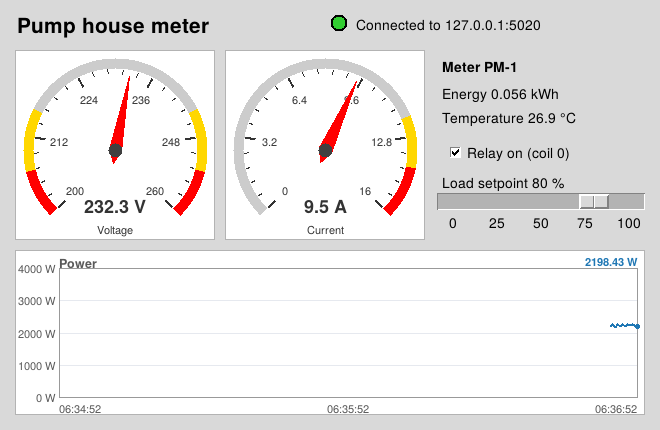
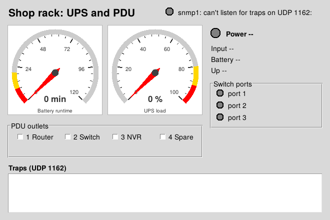
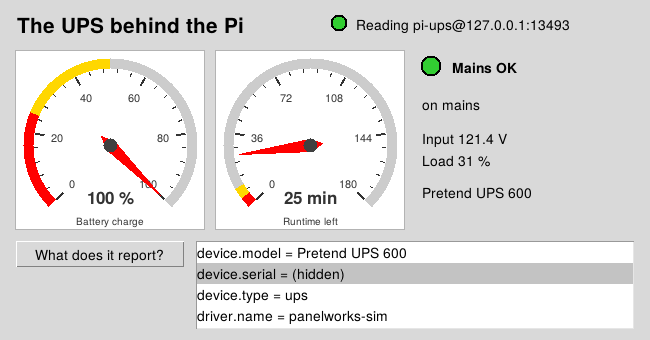

# 17. Modbus, SNMP and NUT

Three tray controls connect PanelWorks to equipment that doesn't speak MQTT:

- **Modbus** is how PLCs, motor drives (VFDs), energy meters, charge controllers and
  most industrial gear share numbers, over Ethernet (Modbus TCP) or RS-485 (Modbus RTU).
- **SNMP** is how network and power equipment reports: UPSes, PDUs, switches, routers
  and servers.
- **NUT** (Network UPS Tools) is how Linux reads a UPS, including the small ones with a
  USB cable. It needs nothing installed in PanelWorks (see the end of this chapter).

Install the one you need (or both) into the same environment as PanelWorks:

```
.venv\Scripts\python -m pip install pymodbus     # Modbus
.venv\Scripts\python -m pip install pysnmp       # SNMP
```

or `pip install -e ".[all]"` from the project folder for everything.

## How these controls work

All three poll the device on a timer, in the background, and hand you the results. You
describe what to read in **Poll**, one line per value:

```
volts   = hr 0 *0.1                 (Modbus: holding register 0, times 0.1)
runtime = upsEstimatedMinutesRemaining     (SNMP: a UPS's runtime)
```

The name on the left is yours. After `=` comes what to read, then optional scaling:
`*0.1`, `/100`, `+32` or `-273.15`, applied left to right.

Then either of these, or both:

- **Fill** puts values straight into properties, with no code, the same as on the Serial
  control: `volts -> gauVolts.Value`, `runtime -> lblRuntime.Caption`.
- **`Name_DataArrival(f, values)`** runs after every poll with a dict of all the values:

```python
def mb1_DataArrival(f, values):
    f.lblPower.Caption = f"{values['volts'] * values['amps']:.0f} W"
    f.shpAlarm.FillColor = "red" if values["volts"] < 207 else "lime green"
```

**PollInterval** sets how often, in milliseconds (Modbus 1000, SNMP and NUT 5000 by default).
**Connected** / **Disconnected** fire when the device starts or stops answering, and
Disconnected also fires once if the device can't be reached at all when the panel starts,
so a lamp driven by these two events is right from the first second. The control
keeps retrying by itself, so a panel left running recovers after a power cut or a
cable swap. **Error(message)** says what went wrong; **LastError** keeps the last one.
`f.mb1.Values` holds the latest values at any time.

To log readings, add a Data control and list the values in its LogFields
(`volts = gauVolts.Value`), or call `f.datLog.Log(values)` in DataArrival.
To pass them on to MQTT, publish on DataArrival: the payload is the values as JSON.

```json
"mb1": {"type": "Modbus", "publish": {"DataArrival": "pumphouse/meter"}, ...}
```

## Modbus



### Connecting

| Property | TCP (Ethernet) | RTU (RS-485 / serial) |
|---|---|---|
| Mode | `TCP` | `RTU` |
| Where | **Host** (IP address) and **Port** (usually 502) | **SerialPort** (`COM5`, `/dev/ttyUSB0`, `auto`) and **Settings** (`9600,n,8,1`, `19200,e,8,1`...) |
| UnitID | Often 1; gateways use it to pick the device behind them | The device's address on the bus (1-247) |

For RTU you'll need a USB-to-RS-485 adapter: A to A, B to B, and the ground if
there is one. Only one master on a bus, so close any other Modbus program first.

### Saying what to read

Modbus devices have four tables. The device's manual lists which values are in
which table, at which address.

| In Poll | Table | Holds | Old-style reference |
|---|---|---|---|
| `hr 100` | Holding registers | numbers you can read and write (setpoints, configuration) | 40101 |
| `ir 100` | Input registers | numbers you can only read (measurements) | 30101 |
| `co 5` | Coils | on/off you can read and write (relays, run commands) | 00006 |
| `di 5` | Discrete inputs | on/off you can only read (switches, alarms) | 10006 |

`hr 100` is **zero-based**: the 101st register. Many manuals print the old reference
instead (40101 means holding register 100), and Poll accepts those too:
`volts = 40101 *0.1`. If your values come out shifted by one register, the manual
is counting from 1: subtract one.

A register is 16 bits. Bigger values span two or four registers. Add the type after
the address:

| Type | Registers | For |
|---|---|---|
| `u16` (default), `i16` | 1 | whole numbers, unsigned or signed |
| `u32`, `i32` | 2 | big counters (energy in Wh) |
| `f32` | 2 | floating point (most modern meters) |
| `u64`, `i64`, `f64` | 4 | rare |
| `str8` | 8 | text, 2 characters per register (model names) |

Coils and discrete inputs are always True/False.

**Byte order.** Devices disagree about which half of a 32-bit value comes first.
If a float reads as nonsense (`1.4e-38`, `-2.3e+12`) or a counter jumps by 65536,
the order is wrong. Try the others with **ByteOrder** (for the whole control) or on
one line (`hr 2 f32 cdab`):

| ByteOrder | Also called | Seen on |
|---|---|---|
| ABCD | big-endian, "Modbus standard" | most PLCs |
| CDAB | word swap, "little-endian word order" | many energy meters, some drives |
| BADC | byte swap | a few |
| DCBA | little-endian | a few |

### Reading and writing from code

```python
temp = f.mb1.Read("ir 10 i16 *0.1")         # one value, right now
f.mb1.Write("co 0", True)                   # switch a coil on
f.mb1.Write("hr 10", 75)                    # a setpoint
f.mb1.Write("hr 20 f32", 21.5)              # a float into two registers
f.mb1.Write("hr 10 *0.1", 23.5)             # sends 235: Write undoes the scaling
```

Write polls again straight away, so the panel shows the new value.
Writing to `ir` or `di` is refused (they're read-only).

### When it doesn't work

| Error | Means |
|---|---|
| can't connect | Wrong Host/Port, the device is off, or another program holds the connection. |
| illegal address | That register doesn't exist on this device. Check the map, and the off-by-one. |
| illegal function | The table is wrong (e.g. you asked for `hr` and it only has `ir`). |
| no response from the device behind the gateway | The gateway is fine but the UnitID or the RS-485 wiring isn't. |
| (timeouts on RTU) | Settings (baud/parity) don't match, A/B swapped, or the UnitID is wrong. |

One bad line doesn't stop the others: the control reports it and keeps polling the rest.

### Try it without a device

```
python -m panelworks --simulator power_meter           (a pretend meter on 127.0.0.1:5020)
python -m panelworks --example power_meter --mcp none
```

The example reads volts, amps, a word-swapped float, a 32-bit counter, a temperature
from an input register, the meter's name as text, and a relay coil. Gauges show volts
and amps, a Chart plots power, the Slider writes the load setpoint, and the CheckBox
switches the relay. Untick it and watch the current drop.

## SNMP



### Connecting

Set **Host** (the device's address), **Port** (161), **Version** and how you log in:

- **v1 / v2c** use a **Community**, a shared password, usually `public` for reading.
  **WriteCommunity** (often `private`) is used for Set.
- **v3** uses a **User** with an **AuthKey** (and **AuthProtocol**, SHA by default)
  and optionally a **PrivKey** for encryption (**PrivProtocol**, AES by default).

Communities and keys are passwords. Write `${UPS_COMMUNITY}` in the property and set
the environment variable, so the real value isn't in the form file:

```
setx UPS_COMMUNITY "MyReadCommunity"
```

On the device, make a read-only community just for the panel if you can, and allow
it only from the PC the panel runs on.

### Saying what to read

Every SNMP value has an OID, a dotted number like `1.3.6.1.2.1.1.3.0`. Device manuals
and MIB browsers list them. You can write the number, or one of the common names
PanelWorks knows:

| Name | What it is |
|---|---|
| `sysDescr`, `sysName`, `sysLocation`, `sysContact` | the device's description and labels |
| `sysObjectID` | the device's make and model as an OID, e.g. `1.3.6.1.4.1.318.1.3.27` (enterprise 318 is APC) |
| `sysUpTime` | time since boot, in hundredths of a second (`sysUpTime /100` for seconds) |
| `ifDescr.N`, `ifOperStatus.N`, `ifAdminStatus.N` | port N's name, and whether it's up (1) or down (2) |
| `ifInOctets.N`, `ifOutOctets.N` (and `ifHC...` 64-bit) | port N's traffic counters |
| `hrProcessorLoad.N`, `hrSystemUptime` | a server's CPU load and uptime |
| `upsIdentManufacturer`, `upsIdentModel`, `upsIdentName` | which UPS it is: handy for telling models apart |
| `upsBatteryStatus`, `upsEstimatedMinutesRemaining`, `upsEstimatedChargeRemaining` | a UPS's battery |
| `upsBatteryVoltage`, `upsBatteryTemperature`, `upsSecondsOnBattery` | more battery |
| `upsInputVoltage.1`, `upsOutputSource`, `upsOutputPercentLoad.1` | mains in, source (3 normal, 5 battery), load |

Names that end in a table index (`ifOperStatus.3`, `upsOutputPercentLoad.1`) take the
row number after the dot. Vendor values (an APC PDU's outlets, a Ubiquiti radio's signal)
use the number.

```
uptime  = sysUpTime /100
port3   = ifOperStatus.3
outlet4 = 1.3.6.1.4.1.318.1.1.4.4.2.1.3.4
```

To find the numbers, walk the device from the Immediate window (Ctrl+G) while the
panel runs:

```
? snmp1.Walk("ifDescr")
? snmp1.Walk("1.3.6.1.4.1.318")
```

### Get, Walk and Set

```python
name = f.snmp1.Get("sysName")
ports = f.snmp1.Walk("ifDescr")            # {"ifDescr.1": "eth0", "ifDescr.2": ...}
f.snmp1.Set("1.3.6.1.4.1.318.1.1.4.4.2.1.3.4", 3, "i")     # APC outlet 4: reboot
f.snmp1.Set("sysLocation", "Pump house", "s")
```

Set's third argument is the type, using `snmpset`'s letters: `i` integer, `u` unsigned,
`g` gauge, `c` counter, `t` timeticks, `s` string, `a` IP address, `o` OID. Leave it out
and numbers go as `i`, text as `s`.

### Traps

Devices can tell you when something happens (on battery, a port down, overheating)
instead of waiting to be polled. Set **TrapPort** (a number, or `${TRAP_PORT:-1162}` like
Port) and point the device's trap destination at the PC:

```python
def snmp1_Trap(f, source, values):
    f.lstLog.AddItem(f"{source}: {values.get('snmpTrapOID')}")
    if values.get("snmpTrapOID") == "1.3.6.1.2.1.33.2.0.1":    # UPS on battery
        f.shpPower.FillColor = "orange"
```

The standard trap port is 162, but on Linux and macOS ports below 1024 need admin
rights. Use 1162 and set the device to send there. On Windows, allow the port through
the firewall. Traps must use **TrapCommunity** (default `public`), or the v3 User.

### When it doesn't work

| Symptom | Likely cause |
|---|---|
| "no answer" | Wrong Host, Port or Version; SNMP off on the device; or the **community is wrong**. Devices ignore a wrong community instead of refusing it, so it looks like a timeout. |
| "no such object" | The OID isn't on this device. Walk its parent to see what is. |
| Set says notWritable / noAccess | Use the WriteCommunity, and check the device allows writes from this PC. |
| No traps | TrapPort not set, a firewall in the way, or the device sends to another address or port. |

### Try it without a device

```
pip install snmpsim pysmi
python -m panelworks --simulator rack_status           (a pretend UPS, PDU and switch on UDP 1161)
python -m panelworks --example rack_status --mcp none
python -m panelworks --simulator rack_status --trap    (in a third window: send an "on battery" trap)
```

The example shows battery runtime and load on Gauges, mains or battery, input and
battery voltage, uptime, three switch ports named from the switch itself (a Walk of
`ifDescr`), four PDU outlets you can switch with Set, and a log of traps.

## NUT: a UPS through Network UPS Tools

A small UPS with a USB cable doesn't do SNMP or Modbus; it speaks USB HID. On Linux the
standard way to read it is **NUT** (Network UPS Tools): a driver talks to the UPS
(`usbhid-ups` for most USB ones), and a small server, **upsd**, hands out its readings on
TCP port 3493. Synology, TrueNAS, pfSense and Home Assistant speak NUT too, so the UPS
behind a NAS reads the same way. The **NUT** control is a upsd client: the same panel reads
a UPS plugged into this computer (Host `127.0.0.1`) or one on another machine. It needs
nothing installed in PanelWorks.



### Setting up NUT where the UPS is plugged in

On a Raspberry Pi (or any Debian/Ubuntu machine), with the UPS's USB cable plugged in:

```
sudo apt install nut
sudo nut-scanner -U                 # finds the UPS and its driver (usually usbhid-ups)
```

Then, in `/etc/nut/`:

| File | What to put in it |
|---|---|
| `nut.conf` | `MODE=netserver` (or `standalone` if only this machine reads it) |
| `ups.conf` | `[pi-ups]` with `driver = usbhid-ups` and `port = auto`, plus the IDs nut-scanner printed |
| `upsd.conf` | `LISTEN 127.0.0.1 3493`, and this machine's LAN address too if other PCs read it |
| `upsd.users` | a user for upsmon (and one with `instcmds = ALL` if a panel should run commands) |
| `upsmon.conf` | `MONITOR pi-ups@localhost 1 <user> <password> primary` |

`sudo systemctl restart nut-server nut-monitor`, then `upsc pi-ups` lists what the UPS
reports. **upsmon** is the part that shuts the computer down cleanly when the battery runs
low. Keep it: a panel watches, upsmon decides.

### The control

| Property | |
|---|---|
| Host, Port | Where upsd is: `127.0.0.1` and `3493` on the same machine. `${VAR}` works. |
| UPS | The name in brackets in `ups.conf` (`pi-ups`). Empty: the first UPS upsd has. |
| Username, Password | From `upsd.users`, only for **Command**. Use `${VAR}` so they stay out of the form. |
| Poll, Fill, PollInterval | As above. What to read is a NUT variable name. |

```
charge  = battery.charge
runtime = battery.runtime /60         minutes (NUT gives seconds)
status  = ups.status                  "OL", "OB DISCHRG", "OB DISCHRG LB"...
volts   = input.voltage
load    = ups.load
```

Every poll is one `LIST VAR`, so the whole list costs one round trip. Numbers arrive as
numbers and everything else as text. Which variables exist depends on the UPS:
`f.nut1.ListVars()` returns all of them, the NUT version of an SNMP Walk.

Some of them identify your own unit: `ups.serial`, `device.serial`, and on some UPSes a MAC
address. **HideSerials** (True by default) shows those as `(hidden)` everywhere: ListVars, Get
and the Poll values. A screenshot of your panel can then go into a forum post without them.
Set it to False if you need the real number, to register a battery warranty, say.

**ups.status** is a few words: `OL` on line (mains), `OB` on battery, `LB` low battery,
`CHRG` charging, `DISCHRG` discharging, `RB` replace battery, plus `BYPASS`, `OVER` (overload)
and a few more. The control reads them for you, whatever your Poll list says:
**OnLine**, **OnBattery**, **LowBattery**, **Charging**, **ReplaceBattery** and **Status**
(the words themselves). When they change, **StatusChange(old, new)** fires. It also fires once
at start-up with `old` empty, so a lamp is right from the first poll:

```python
def nut1_StatusChange(f, old, new):
    if f.nut1.OnBattery:
        f.shpMains.FillColor = "red" if f.nut1.LowBattery else "orange"
    else:
        f.shpMains.FillColor = "lime green"
```

Alarm rules (chapter 18) can use the values and the status properties:

```
OnBattery:  nut1.OnBattery == True   delay=10 priority=2 message=UPS on battery
LowBattery: nut1.LowBattery == True  priority=1 message=UPS battery low
LowCharge:  nut1.charge < 30         priority=2 message=UPS charge under 30 %
UpsLost:    nut1.Connected == False  delay=30 priority=2 message=No word from the UPS
```

When the driver loses the UPS (the USB cable comes out, the driver stops), upsd answers
`ERR DATA-STALE` or `ERR DRIVER-NOT-CONNECTED`. The control counts that as the link being
down: **Disconnected** fires, the link banner (chapter 8) says so, and it reconnects by itself
when the UPS is back.

| Method | |
|---|---|
| `ListVars()` | Everything the UPS reports, as a dict. |
| `Get("battery.voltage")` | One variable, read now (or a Poll name's last value). |
| `ListUPS()` | The UPSes this upsd serves. |
| `ListCommands()` | The instant commands the UPS supports. |
| `Command("test.battery.start.quick")` | Run one. Needs Username and Password. |

ListVars, Get and the others ask upsd while you wait (up to **Timeout**, 3 s), so call them
from a button or Form_Load, not from a Timer that ticks every second.

### When it doesn't work

| Symptom | Likely cause |
|---|---|
| "can't reach upsd" | NUT isn't running there, or `upsd.conf` doesn't LISTEN on the address you're using (only `127.0.0.1` by default). A firewall can block 3493 too. |
| "no UPS called ..." | The UPS name doesn't match `ups.conf`; the message lists the ones upsd has. |
| "lost the UPS" (DATA-STALE) | The driver can't reach the UPS: check the USB cable, then `upsc pi-ups` on that machine. |
| A Poll variable "isn't reported" | Not every UPS has every variable. `ListVars()` shows what yours has. |
| Command says it needs a Username | Set Username and Password to a `upsd.users` user with `instcmds`. |

### Try it without a UPS

```
python -m panelworks --simulator nut                    (a pretend upsd on TCP 13493)
python -m panelworks --example nut --mcp none
```

The pretend UPS cuts its mains every minute or so, runs down to low battery and recovers.
In the simulator's window, type `cut`, `back`, `stale` (as if the USB cable came out) or `ok`.
For a real UPS, set `NUT_HOST`, `NUT_PORT=3493` and `NUT_UPS` in the environment.
