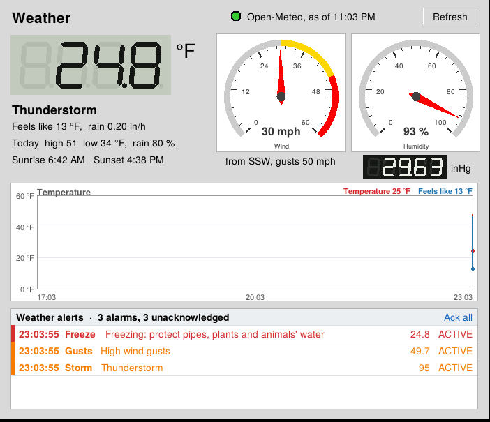

# 19. Web APIs (WebRequest)

Weather services, solar forecasts, your Home Assistant, an n8n webhook, a stock price:
most of the world's data is a web address that answers with JSON. The **WebRequest**
control reads one on a timer and puts the values on your panel, like VB's Inet
control did, usually with no code at all. It works like the Modbus and SNMP controls
(chapter 17): a **Poll** list of values to read, **Fill** to drive controls, and a
**DataArrival** event.

It needs nothing extra installed.

## A weather panel in five minutes

Open-Meteo is a free weather service that needs no account or key. This address asks
it for the current temperature and wind near Nashville, in °F and mph:

```
https://api.open-meteo.com/v1/forecast?latitude=36.16&longitude=-86.78&current=temperature_2m,wind_speed_10m&temperature_unit=fahrenheit&wind_speed_unit=mph
```

Paste it into a browser and you see the reply:

```json
{"latitude": 36.16, "longitude": -86.78, "current":
  {"time": "2026-11-22T14:00", "temperature_2m": 48.6, "wind_speed_10m": 9.4}}
```

1. Draw a **SegmentDisplay** (`segTemp`; Style LCD, Digits 4, Decimals 1) and a
   **Gauge** (`gauWind`; Max 60, Units mph).
2. Add a **WebRequest** from the toolbox. It goes in the tray as `web1`.
3. Set **URL** to the address above.
4. Set **Poll** to one line per value, each a path into the reply:

   ```
   temp = current.temperature_2m
   wind = current.wind_speed_10m
   ```

5. Set **Fill** to:

   ```
   temp -> segTemp.Value
   wind -> gauWind.Value
   ```

6. Set **PollInterval** to `600000` (10 minutes, in milliseconds) and press **F5**.

The display and the gauge show the weather and update every ten minutes.

## Paths into the reply

A Poll line is `name = path`, where the path walks into the JSON with dots, and
square brackets (or a dot) pick an item from a list:

| Reply | Path |
|---|---|
| `{"current": {"temperature_2m": 48.6}}` | `current.temperature_2m` |
| `{"weather": [{"description": "light rain"}]}` | `weather[0].description` (or `weather.0.description`) |
| `{"daily": {"sunrise": ["06:42", "06:43"]}}` | `daily.sunrise[0]` |

Scaling works as in chapter 17, after the path: `temp_c = main.temp -273.15`
(Kelvin to °C), `pressure = current.pressure_msl *0.02953` (hPa to inHg). Text values
such as a description come through as text.

A path that isn't in the reply is reported once, in the Immediate window and the
**Error** event, and the other values still arrive.

**No Poll lines** means DataArrival gets the whole reply, and Fill can use full paths
(`current.temperature_2m -> segTemp.Value`). That's handy for exploring a new API:

```python
def web1_DataArrival(f, values):
    print(values)                     # see everything in the Immediate window (Ctrl+G)
```

## Keys, tokens and headers

Many services need a key. Keep it out of the form file with `${VARIABLE}`, which is
filled in from the environment when the request is made:

```
URL:      https://api.openweathermap.org/data/2.5/weather?q=Nashville,US&units=imperial&appid=${OWM_KEY}
Headers:  Authorization: Bearer ${HA_TOKEN}
```

Set the variable before starting the panel (`set OWM_KEY=abc123` in the Command
Prompt, or in Windows' environment variables for good). The WebRequest never shows
the part of the address after the `?` in its messages or its **Target** property, so
a key in the URL doesn't end up on screen or in a screenshot.

**Headers** takes one `Name: value` per line. **Method** is GET (the usual), POST or
PUT; for POST and PUT, **Body** is the text to send, also with `${VAR}`, sent as JSON
when it starts with `{` or `[`.

## Being a good neighbour

Free APIs ask you not to ask too often. Open-Meteo's current conditions move in
15-minute steps, so asking more often gets the same answer, and OpenWeather's free plan
allows 60 calls a minute in total (going over gets HTTP 429). A **PollInterval** of 5
to 15 minutes is plenty for weather. After a failure the control
waits before trying again (at least 5 seconds, at most a minute), so a dropped
internet link doesn't hammer the service. **PollInterval 0** asks only when your code
calls `PollNow()`, as the example's Refresh button does.

## When something goes wrong

The **Error** event and the Immediate window say what happened:

| Message | Means |
|---|---|
| `HTTP 401 Unauthorized: check the API key or token` | The key is missing or wrong, or the variable isn't set |
| `HTTP 404 Not Found: check the URL` | A typo in the address |
| `HTTP 429 ...: make PollInterval longer` | You're asking too often |
| `can't reach it (...)` | No internet, or the name doesn't resolve |
| `no reply (timed out)` | The service is slow; raise **Timeout** (seconds, default 15) |
| `not in the reply: ...` | A Poll path doesn't match the reply; look at **Response** |

**Response** holds the raw text of the last reply, **StatusCode** its HTTP status, and
**LastUpdate** when it arrived. **Connected** is True while replies keep coming, and
the Connected and Disconnected events fire when that changes, so a lamp can show
whether the data is fresh.

## In code

```python
def cmdRefresh_Click(f):
    f.wx.PollNow()                                  # ask now instead of waiting

def cmdCheck_Click(f):
    r = f.web1.Fetch("https://api.example.com/status")   # ask once, get the reply back
    f.lblStatus.Caption = r["status"]
```

`Fetch` waits for the answer (up to **Timeout** seconds), so the panel pauses until it
comes. Keep it for occasional button presses, and let the Poll list do the regular
reading.

## The weather example

`examples/weather` reads Open-Meteo every 10 minutes: temperature on an LCD
SegmentDisplay, wind and humidity on gauges, pressure on a reverse LCD, today's high,
low and chance of rain, sunrise and sunset, and the condition in words. Alarms warn of
freezing temperatures, high gusts and thunderstorms, and of no update for 30 minutes.



```
python -m panelworks --example weather --mcp none
```

It uses Nashville until you set **WEATHER_LAT** and **WEATHER_LON** to your own
location (decimal degrees; west and south are negative). Without an internet
connection, run the pretend Open-Meteo and point the panel at it:

```
python -m panelworks --simulator weather
set WEATHER_URL=http://127.0.0.1:5023/v1/forecast
python -m panelworks --example weather --mcp none
```

The pretend service sends a cold front through every six minutes, so the alarms have
something to do.
